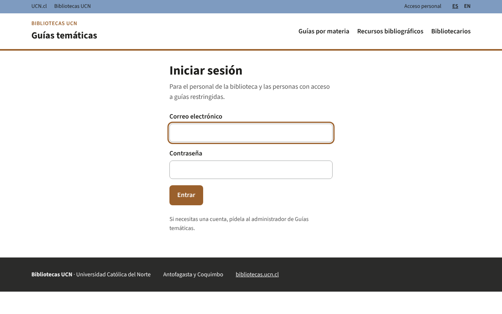
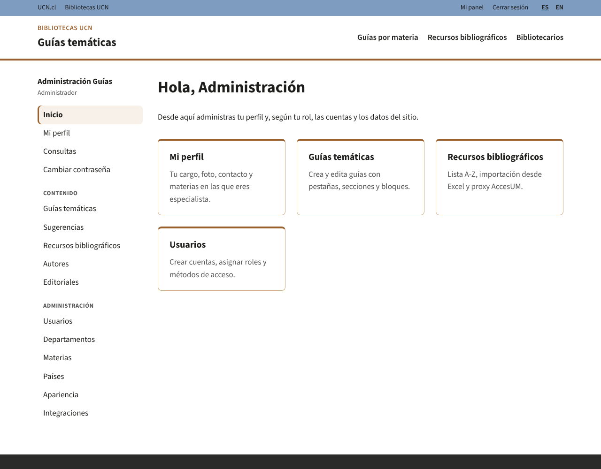
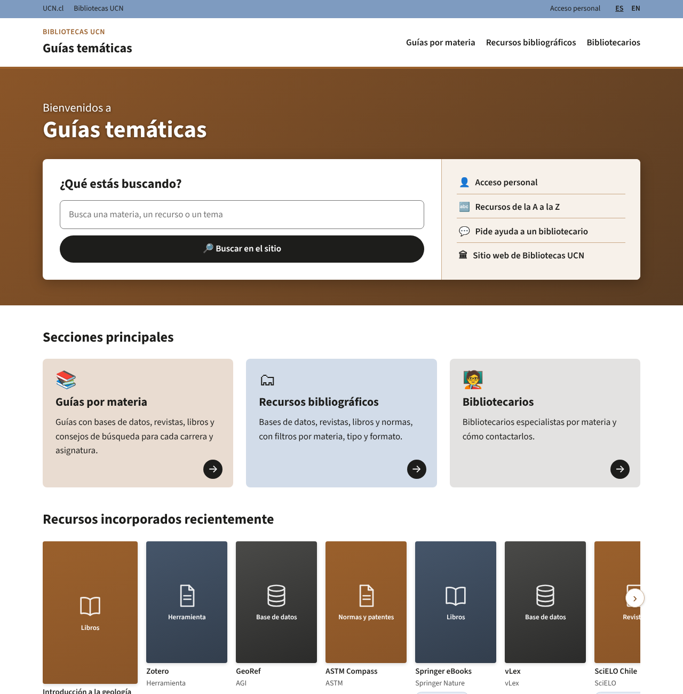
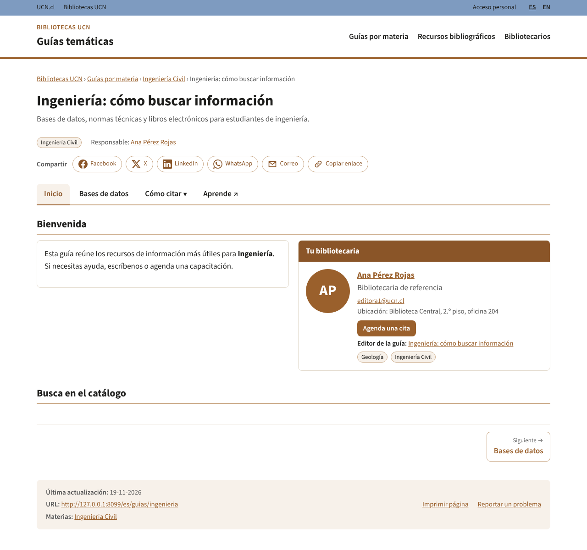
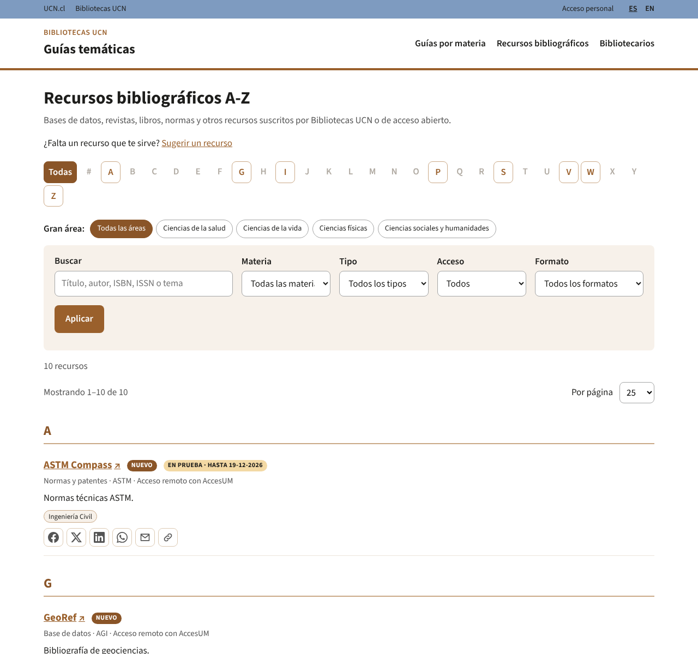
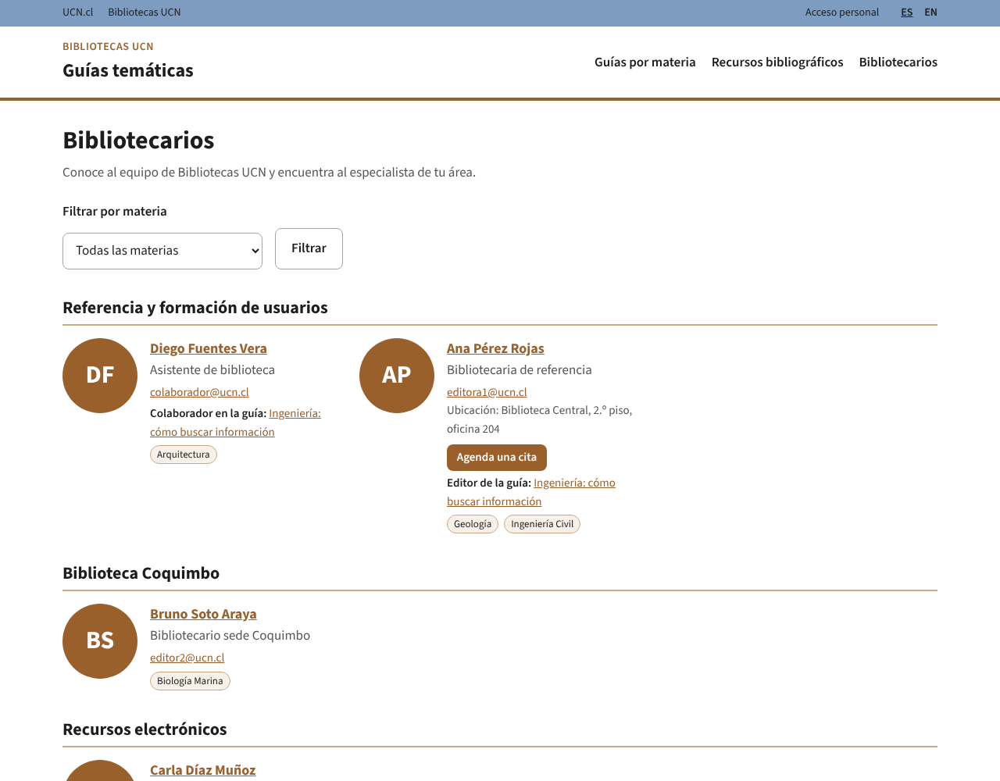
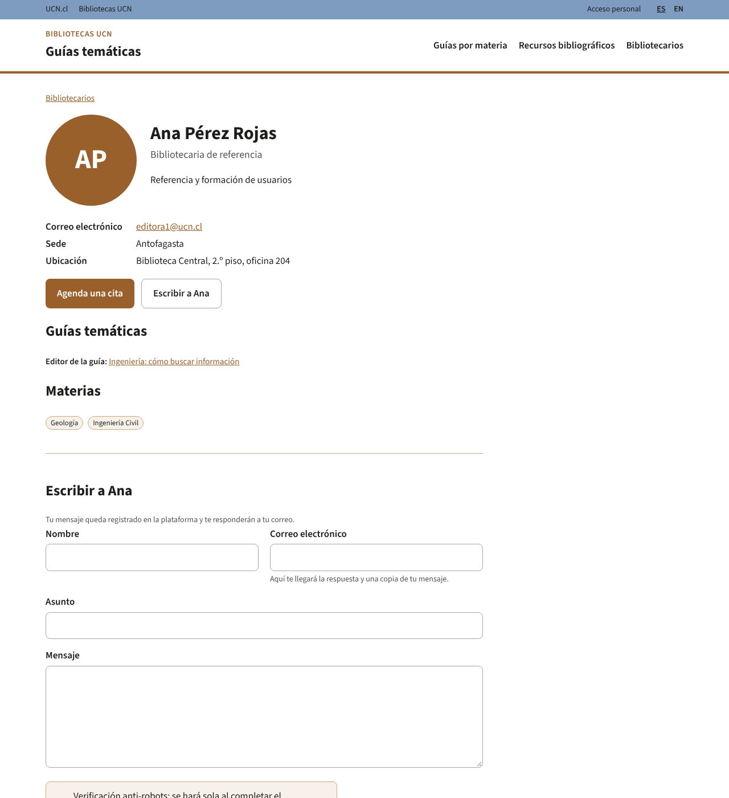
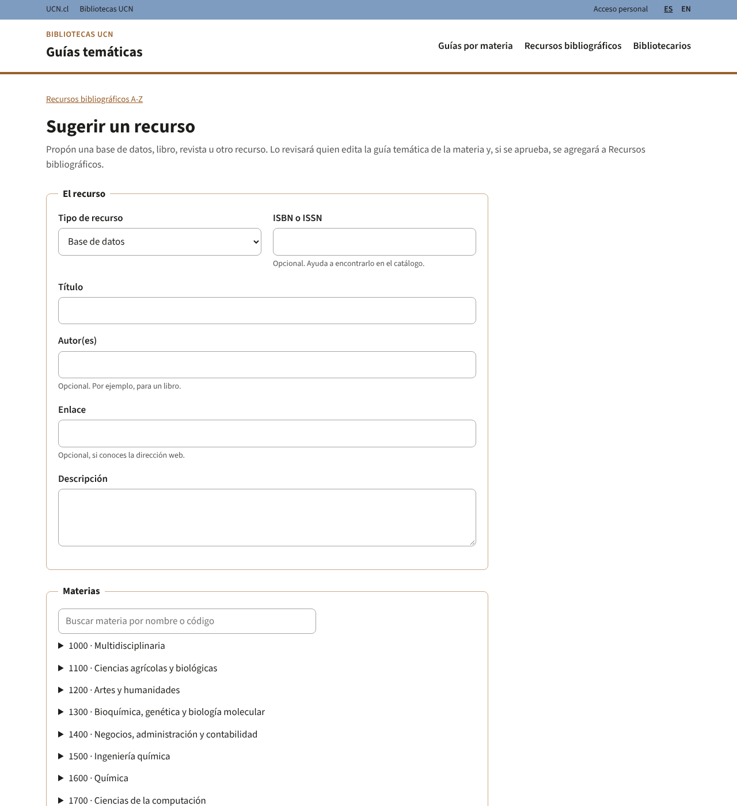

# 1. Introducción

## 1.1 ¿Qué es la plataforma?

La plataforma de **Guías temáticas** reúne, por materia, los recursos de información que Bibliotecas UCN recomienda:
bases de datos, revistas, libros, normas, sitios web, videos y consejos de búsqueda. Cada guía la prepara un
bibliotecario o bibliotecaria y se publica en el sitio para estudiantes y académicos.

La plataforma tiene dos partes:

- **El sitio público**, que ve cualquier persona: portada, guías por materia, lista de recursos bibliográficos A-Z y
  directorio de bibliotecarios.
- **El panel de trabajo**, donde el personal de la biblioteca crea y mantiene las guías y los recursos. Solo entran
  las personas que un administrador ha registrado.

El sitio está en español e inglés: el selector **ES / EN** de la barra superior cambia el idioma de la interfaz.

## 1.2 Roles y permisos

Cada persona tiene uno de estos roles. Los permisos se suman de abajo hacia arriba: un editor puede hacer todo lo que
hace un colaborador, y un administrador todo lo que hace un editor.

| Acción | Lector | Colaborador | Editor | Administrador |
| ---------------------------------------- | :-------: | :---------: | :-------: | :-----------: |
| Ver las guías restringidas que tiene asignadas | ✔ | ✔ | ✔ | ✔ |
| Entrar al panel, editar su perfil y responder consultas | | ✔ | ✔ | ✔ |
| Editar el contenido (pestañas, secciones y bloques) de las guías en que es coeditor | | ✔ | ✔ | ✔ |
| Revisar sugerencias de recursos de sus materias | | ✔ | ✔ | ✔ |
| Crear guías, publicarlas, elegir coeditores y eliminarlas | | | ✔ | ✔ |
| Crear guías con el asistente de inteligencia artificial | | | ✔ | ✔ |
| Gestionar la lista de recursos A-Z, autores y editoriales; importar y exportar | | | ✔ | ✔ |
| Editar todas las guías y cambiar su responsable | | | | ✔ |
| Gestionar usuarios, departamentos, materias y países | | | | ✔ |
| Cambiar la apariencia del sitio y las integraciones (catálogo, LDAP, correo, IA…) | | | | ✔ |

- **Responsable de una guía:** el editor que la creó (o a quien el administrador se la asignó). Es quien edita los
  datos de la guía, la publica y la elimina.
- **Coeditores:** editores o colaboradores que el responsable agrega a la guía. Editan su contenido, pero no sus datos
  ni su publicación.
- **Lector:** persona que solo inicia sesión para ver guías de acceso restringido (por ejemplo, un curso piloto). No
  entra al panel ni aparece en el directorio.

## 1.3 Cómo entrar

1. Abre la plataforma y elige **Acceso personal** en la barra superior (o entra directo a `/es/acceso`).
2. Escribe tu correo electrónico y tu contraseña y presiona **Entrar**.

Según lo que haya configurado el administrador, la pantalla puede ofrecer hasta tres formas de entrar:

| Forma | Qué escribes |
| ------------ | ---------------------------- |
| Contraseña propia | Tu correo y la contraseña que te dio el administrador (mínimo 12 caracteres) |
| Cuenta institucional (LDAP) | Tu usuario y contraseña de la UCN |
| Google | Botón «Entrar con Google», con la cuenta cuyo correo coincide con el registrado |

Nadie puede registrarse solo: si no tienes cuenta, pídela al administrador de la plataforma. Para salir usa
**Cerrar sesión** en la barra superior. Por seguridad, cierra la sesión si usas un computador compartido.

## 1.4 El panel de trabajo

Al entrar llegas a **Inicio** del panel. A la izquierda está el menú, agrupado en secciones; cada persona ve solo
las opciones de su rol.

| Sección del menú | Opciones | Roles |
| ---------- | ------------------------- | --------------- |
| (sin título) | Inicio, Mi perfil, Consultas, Cambiar contraseña | Todo el personal |
| Contenido | Guías temáticas, Sugerencias | Todo el personal |
| Contenido | Recursos bibliográficos, Autores, Editoriales | Editor y administrador |
| Administración | Usuarios, Departamentos, Materias, Países, Apariencia, Integraciones | Administrador |

Junto a **Consultas** y **Sugerencias** aparece un número cuando hay mensajes o sugerencias pendientes.

En las tablas del panel, las acciones son botones con icono (✏️ editar, 🗑️ eliminar, 👁️ ver, etc.). Al pasar el
mouse sobre ellos aparece su nombre. Antes de eliminar algo, la plataforma pide confirmación en una ventana.

## 1.5 Lo que ve el público

Conviene conocer el sitio público, porque es el resultado de todo lo que se hace en el panel.

**Portada.** Imagen de fondo con un buscador (catálogo de la biblioteca o el propio sitio), accesos rápidos, tarjetas
de las secciones principales y un carrusel con los recursos agregados más recientemente.

**Guía publicada.** Cada guía tiene pestañas (arriba o en un menú lateral), y cada pestaña muestra sus secciones y
bloques. Arriba aparecen la ruta (migas de pan), el responsable y botones para compartir la guía; abajo, la fecha de
actualización, las materias y los botones Imprimir y Reportar un problema.

**Recursos bibliográficos A-Z.** Lista de todos los recursos visibles, con índice alfabético y filtros por materia,
tipo, acceso y formato. Los recursos suscritos se abren a través del proxy AccesUM, para que funcionen también fuera
del campus.

**Bibliotecarios.** Directorio del personal con su ficha pública: cargo, contacto, guías que edita, materias y un
formulario «Escribir a…» para enviarle una consulta.

**Sugerir un recurso.** Cualquier persona puede proponer un recurso que falte en la lista, sin crear cuenta. La
sugerencia llega al panel (ver [2.4 Sugerencias](02-funciones-comunes.md#24-sugerencias-de-recursos)).

Los formularios públicos tienen una verificación anti-robots propia que se resuelve sola mientras la persona escribe:
no hay que marcar casillas ni reconocer imágenes.
