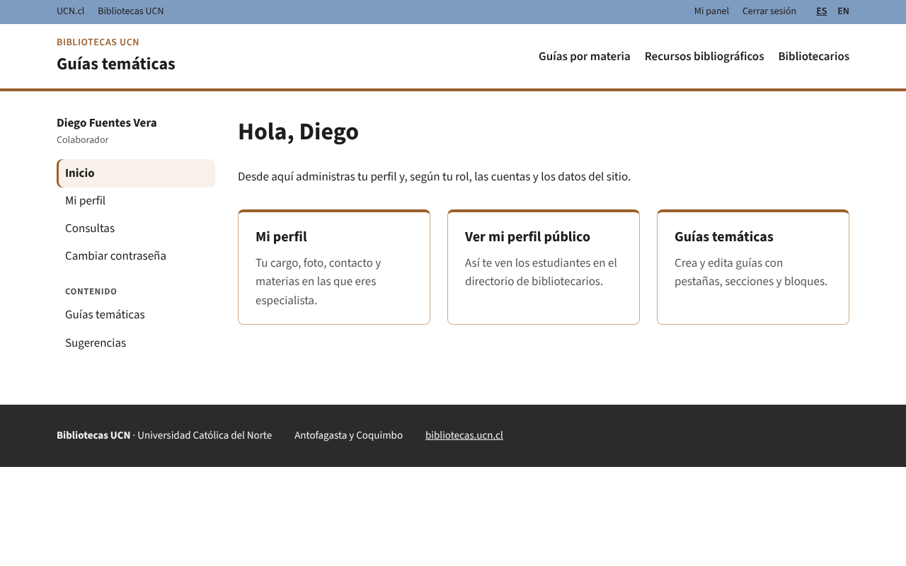
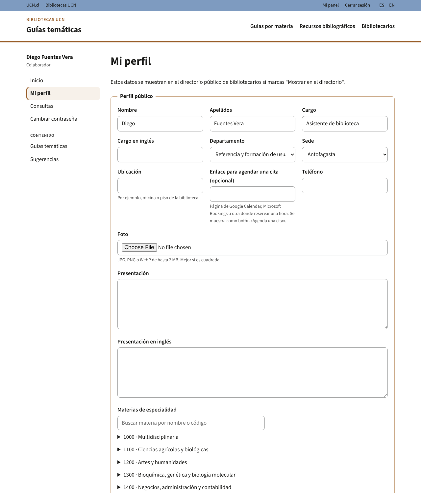
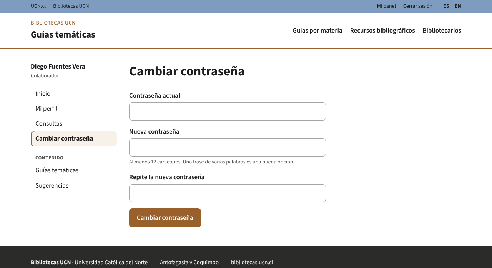
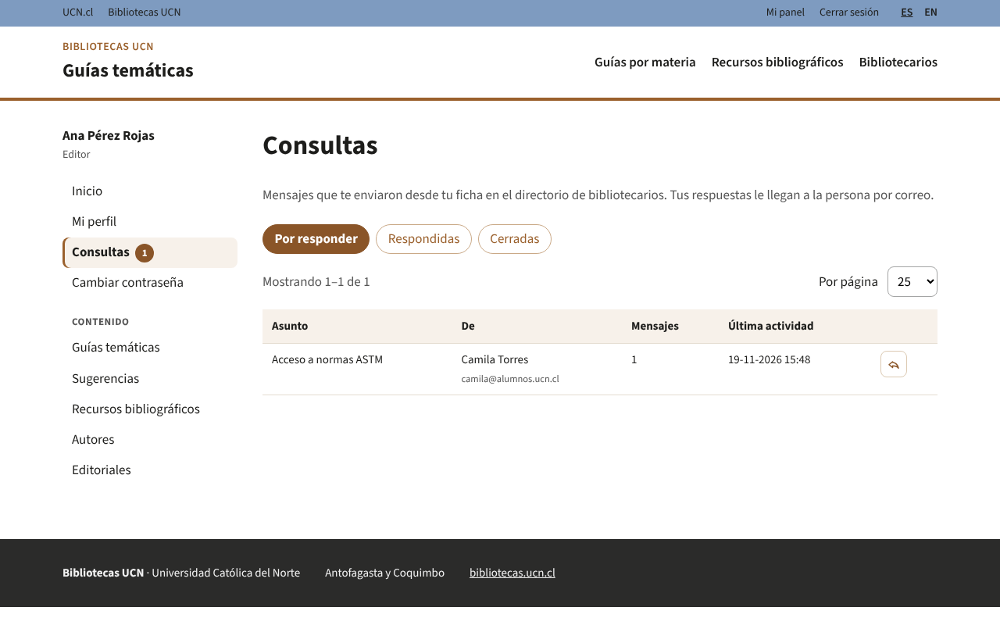
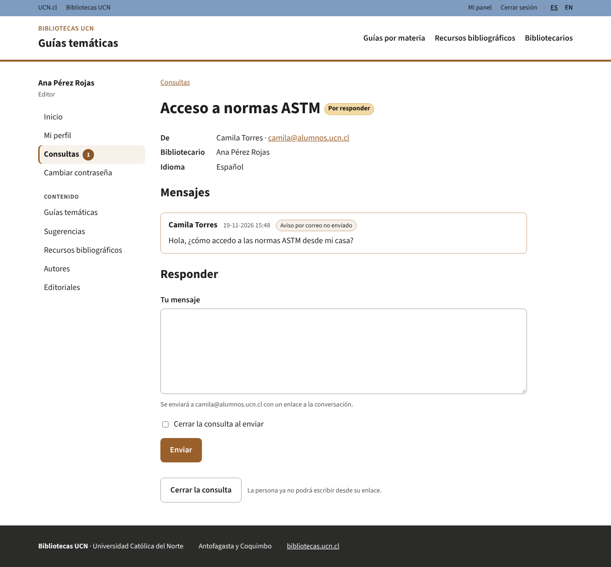
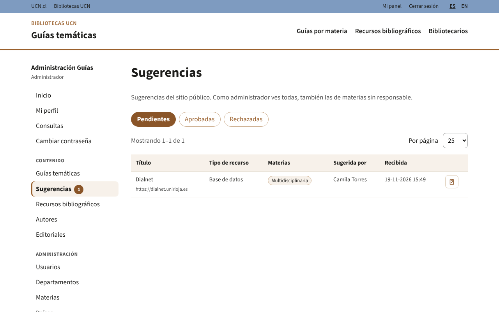
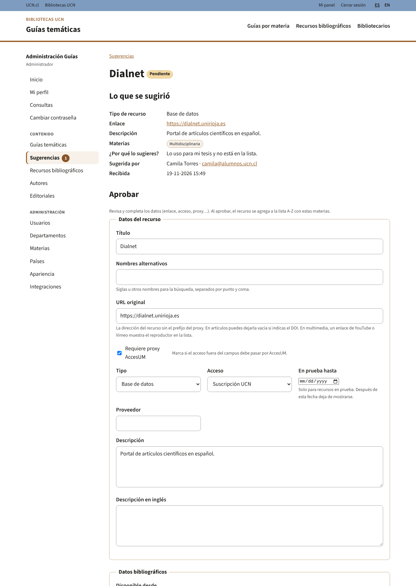

# 2. Funciones comunes del personal

Este capítulo vale para administradores, editores y colaboradores.

## 2.1 Mi perfil

En **Mi perfil** completas los datos que aparecen en tu ficha pública del directorio de bibliotecarios y en el bloque
«Perfil del bibliotecario» de las guías.

| Campo | Para qué sirve |
| ------------ | ---------------------------- |
| Nombre, apellidos | Cómo te muestran en el sitio |
| Cargo y cargo en inglés | Aparece bajo tu nombre (el segundo, en la versión en inglés) |
| Departamento y sede | Agrupan el directorio |
| Ubicación | Oficina o piso, por ejemplo «Biblioteca Central, 2.º piso, oficina 204» |
| Enlace para agendar una cita | Página de Google Calendar, Microsoft Bookings u otra; se muestra como botón «Agenda una cita» |
| Teléfono | Opcional |
| Foto | JPG, PNG o WebP de hasta 2 MB, mejor cuadrada |
| Presentación y presentación en inglés | Texto breve sobre ti y tu trabajo |
| Materias de especialidad | Apareces como contacto en las guías de esas materias y recibes sus sugerencias de recursos |
| Mostrar en el directorio de bibliotecarios | Si lo desmarcas, tu ficha pública deja de verse |

Las materias se eligen en una lista agrupada por campo (las categorías ASJC de Scopus); el buscador de arriba filtra
por nombre o código.

**Ejemplo.** Ana es bibliotecaria de referencia para Ingeniería y Geología. En **Materias de especialidad** busca
«ingeniería civil» y «geología» y marca ambas; en **Enlace para agendar una cita** pega su página de Microsoft
Bookings. Al guardar, su ficha pública muestra el botón «Agenda una cita», y las sugerencias de recursos de esas
materias le llegan a su bandeja.

Para ver cómo te ve el público, usa **Ver mi perfil público** en el inicio del panel.

## 2.2 Cambiar contraseña

Solo aplica si entras con contraseña propia (no con LDAP ni Google). Escribe la contraseña actual y dos veces la nueva,
de al menos 12 caracteres. Una frase larga y fácil de recordar es más segura que una palabra corta con símbolos.

Si olvidaste tu contraseña, pide al administrador que te asigne una nueva.

## 2.3 Consultas de usuarios

Cuando alguien escribe desde tu ficha pública («Escribir a…»), el mensaje llega a **Consultas**. La persona recibe una
copia por correo con un enlace privado para seguir la conversación.

La bandeja tiene tres pestañas: **Por responder**, **Respondidas** y **Cerradas**. El administrador puede elegir entre
ver solo las suyas o las de todos los bibliotecarios.

Para responder:

1. Abre la consulta desde la bandeja.
2. Escribe tu respuesta en **Responder** y presiona **Enviar**. Le llega a la persona por correo y queda registrada.
3. Si el tema está resuelto, marca **Cerrar la consulta al enviar**, o usa **Cerrar la consulta** más abajo. Una
   consulta cerrada se puede reabrir.

**Ejemplo.** Camila, estudiante, escribe a Ana: «¿Cómo accedo a las normas ASTM desde mi casa?». Ana responde con los
pasos para entrar por AccesUM. Si deja la consulta abierta y Camila contesta desde su enlace, la consulta vuelve a
**Por responder**. Si Ana marca **Cerrar la consulta al enviar**, Camila ya no puede contestar en esa conversación y
tendría que escribir una nueva desde la ficha.

> Los correos salen solo si el administrador configuró el servidor de correo (ver
> [5.7 Integraciones](05-administrador.md#57-integraciones)). Sin él, las consultas se registran igual y se responden
> desde el panel, pero la persona no recibe el aviso.

## 2.4 Sugerencias de recursos

El público puede sugerir recursos que faltan en la lista A-Z. Cada sugerencia la revisan:

- las personas que tienen alguna de sus materias en **Mi perfil**,
- los responsables y coeditores de guías de esas materias,
- y el administrador, que ve todas.

Al abrir una sugerencia ves **Lo que se sugirió** (tipo, título, enlace, motivo y quién la envió). Si ya hay un recurso
parecido en la lista, aparece el aviso «Posible duplicado».

- **Aprobar:** revisa y completa los datos (enlace, tipo, acceso, si requiere proxy, materias) y presiona
  **Aprobar y agregar a la lista**. El recurso entra a la lista A-Z.
- **Rechazar:** opcionalmente escribe el motivo (queda registrado para el equipo) y presiona **Rechazar sugerencia**.

Una sugerencia revisada pasa a **Aprobadas** o **Rechazadas** con el nombre de quien la revisó y la fecha.

**Ejemplo.** Llega la sugerencia «Dialnet» para Multidisciplinaria. Al revisarla, compruebas que es de acceso abierto,
eliges **Acceso: Acceso abierto**, desmarcas **Requiere proxy** y apruebas. Desde ese momento Dialnet aparece en la
lista A-Z y se puede agregar a las guías.
