# 3. Manual del colaborador: editar el contenido de una guía

Un **colaborador** edita las guías en que el responsable lo agregó como **coeditor**. Puede crear, cambiar, ordenar y
eliminar pestañas, secciones y bloques. No puede cambiar los datos de la guía (título, materias, visibilidad), ni
publicarla, ni eliminarla: eso lo hace su responsable (ver [capítulo 4](04-editor.md)).

Todo este capítulo vale también para editores y administradores.

## 3.1 Mis guías

**Guías temáticas** muestra las guías que puedes editar, con su estado (Borrador o Publicada), responsable, fecha de
la última actualización y visitas.

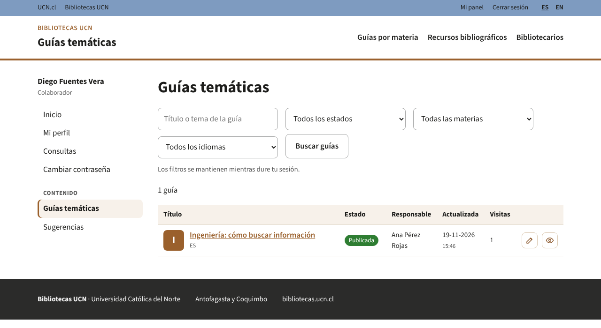

Sobre la tabla hay filtros por texto, estado, materia, idioma y, si hay varios, responsable. **Los filtros se
mantienen mientras dure tu sesión**: si entras a editar una guía y vuelves, el listado sigue filtrado. **Limpiar
filtros** los quita.

Haz clic en el título (o en ✏️) para abrir el editor de la guía.

## 3.2 Cómo está organizada una guía

```
Guía
├── Pestaña «Inicio»
│   ├── Sección «Bienvenida» (2 columnas)
│   │   ├── Bloque Texto
│   │   └── Bloque Perfil del bibliotecario
│   └── Sección «Busca en el catálogo»
│       └── Bloque Búsqueda en el catálogo
├── Pestaña «Bases de datos»
│   └── …
└── Pestaña «Cómo citar»
    └── Subpestaña «Normas APA»
```

- **Pestaña:** una página de la guía. Puede ser subpestaña de otra (un solo nivel) o un enlace externo.
- **Sección:** un grupo de bloques con título, que reparte sus bloques en 1, 2 o 3 columnas (en celulares, siempre en
  una).
- **Bloque:** una caja con contenido: texto, recursos, libros, un video, etc.

## 3.3 El editor de la guía

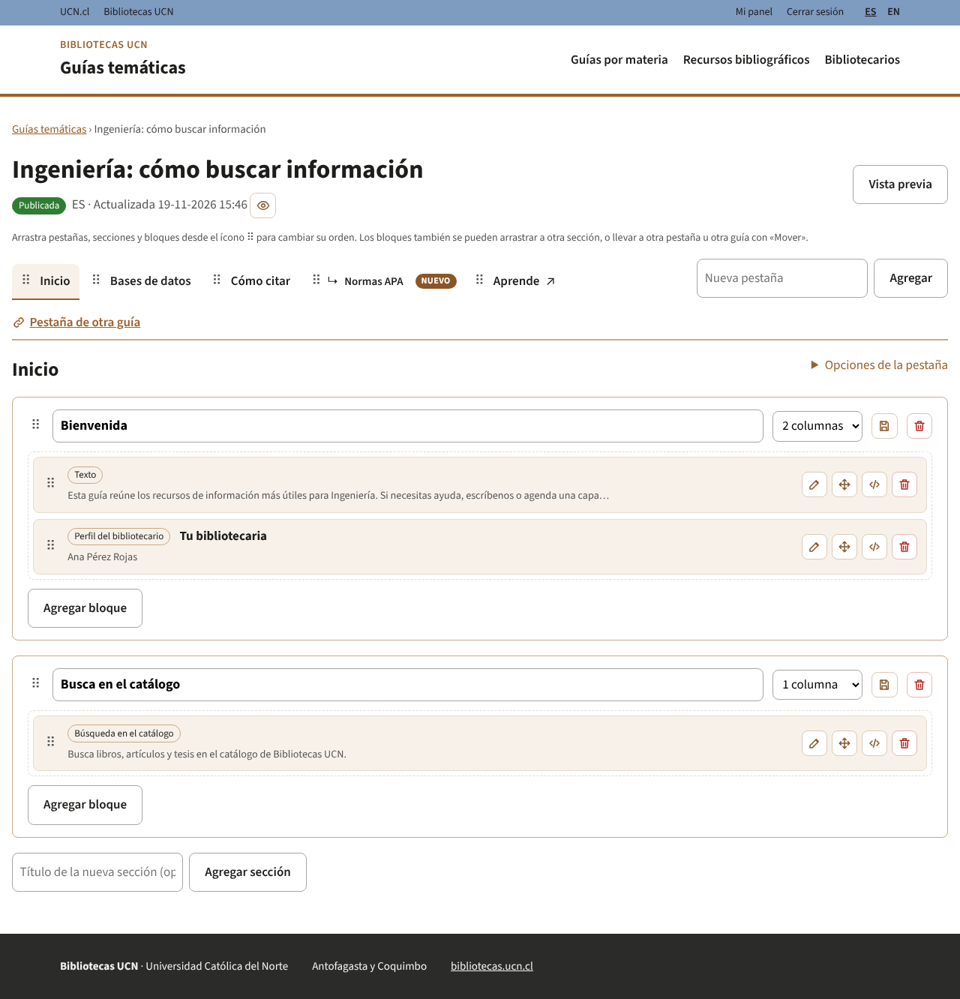

De arriba hacia abajo:

1. **Cabecera:** título, estado y fecha de actualización, y los botones **Vista previa**, **Ver publicada** y (solo
   para el responsable) **Datos de la guía** y **Publicar / Pasar a borrador**.
2. **Barra de pestañas:** un clic abre la pestaña. Al final, el campo **Nueva pestaña** con el botón **Agregar**, y el
   enlace **Pestaña de otra guía**.
3. **Contenido de la pestaña:** sus secciones, cada una con sus bloques y el botón **Agregar bloque**. Al final, el
   campo para **Agregar sección**.

### Ordenar arrastrando

Pestañas, secciones y bloques se reordenan arrastrando el icono **⠿** que tienen a la izquierda. Un bloque puede
arrastrarse a otra sección de la misma pestaña. El orden se guarda solo al soltar.

### Pestañas

- **Agregar:** escribe el nombre en **Nueva pestaña** y presiona **Agregar**. Se crea con una sección vacía.
- **Opciones de la pestaña** (enlace a la derecha del título de la pestaña abierta):

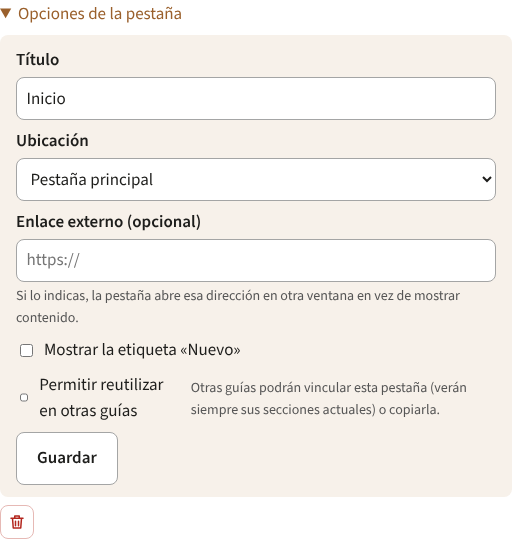

| Opción | Efecto |
| ------------ | ---------------------------- |
| Título | Nombre que se ve en la barra de pestañas |
| Ubicación | «Pestaña principal» o «Subpestaña de…» otra pestaña (se despliega bajo ella) |
| Enlace externo | Si lo indicas, la pestaña abre esa dirección en otra ventana en vez de mostrar contenido |
| Mostrar la etiqueta «Nuevo» | Destaca la pestaña con una etiqueta |
| Permitir reutilizar en otras guías | Otras guías podrán vincular o copiar esta pestaña (ver 3.6) |

- **Eliminar:** el botón 🗑️ bajo las opciones borra la pestaña con todo su contenido, después de confirmar.

### Secciones

Cada sección tiene un campo de título, un selector de **columnas** (1, 2 o 3) y los botones 💾 (guardar título y
columnas) y 🗑️ (eliminar la sección y sus bloques). Para crear una, escribe el título en **Agregar sección** al final
de la pestaña.

### Bloques

Cada bloque muestra un resumen y estos botones:

| Botón | Qué hace |
| ------------ | ---------------------------- |
| ✏️ Editar | Abre el formulario del bloque |
| ✥ Mover | Lo lleva a otra sección, de esta u otra pestaña, o a otra guía que puedas editar |
| </> Incrustar | Entrega el código para mostrar el bloque en otra web (Moodle, sitio de una carrera) |
| 🗑️ Eliminar | Lo borra, después de confirmar |

**Agregar bloque** despliega los tipos disponibles:

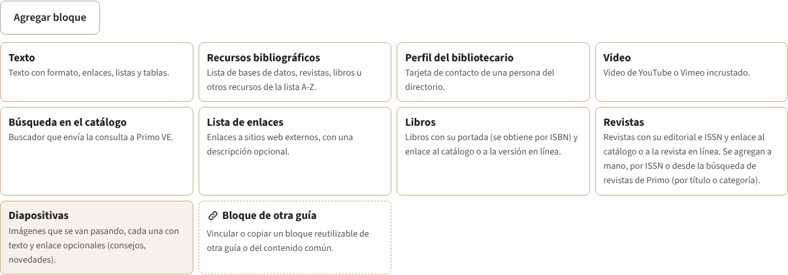

## 3.4 Tipos de bloque

Todos los bloques tienen un **Título** opcional (se muestra en la barra de la caja) y la casilla **Permitir
reutilizar en otras guías**.

### Texto

Editor con formato: negrita, cursiva, listas, enlaces, tablas, títulos. El texto pegado desde Word se limpia de
estilos extraños al guardar.

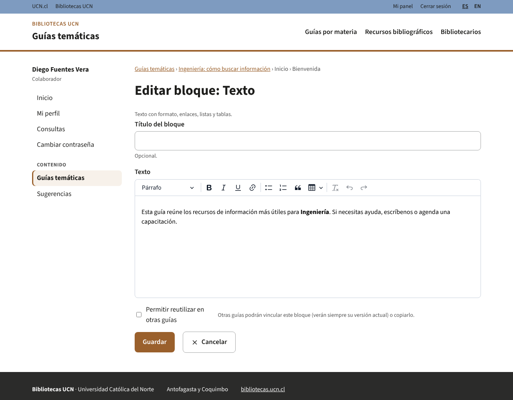

**Ejemplo.** En la pestaña «Cómo citar», un bloque Texto titulado «Normas de citación» explica en una lista breve que
IEEE usa referencias numeradas y APA autor y año.

### Recursos bibliográficos

Muestra recursos elegidos de la lista A-Z (bases de datos, revistas, libros, normas, herramientas…). Su enlace pasa
por el proxy cuando corresponde, y los de acceso abierto llevan la marca «Recurso libre».

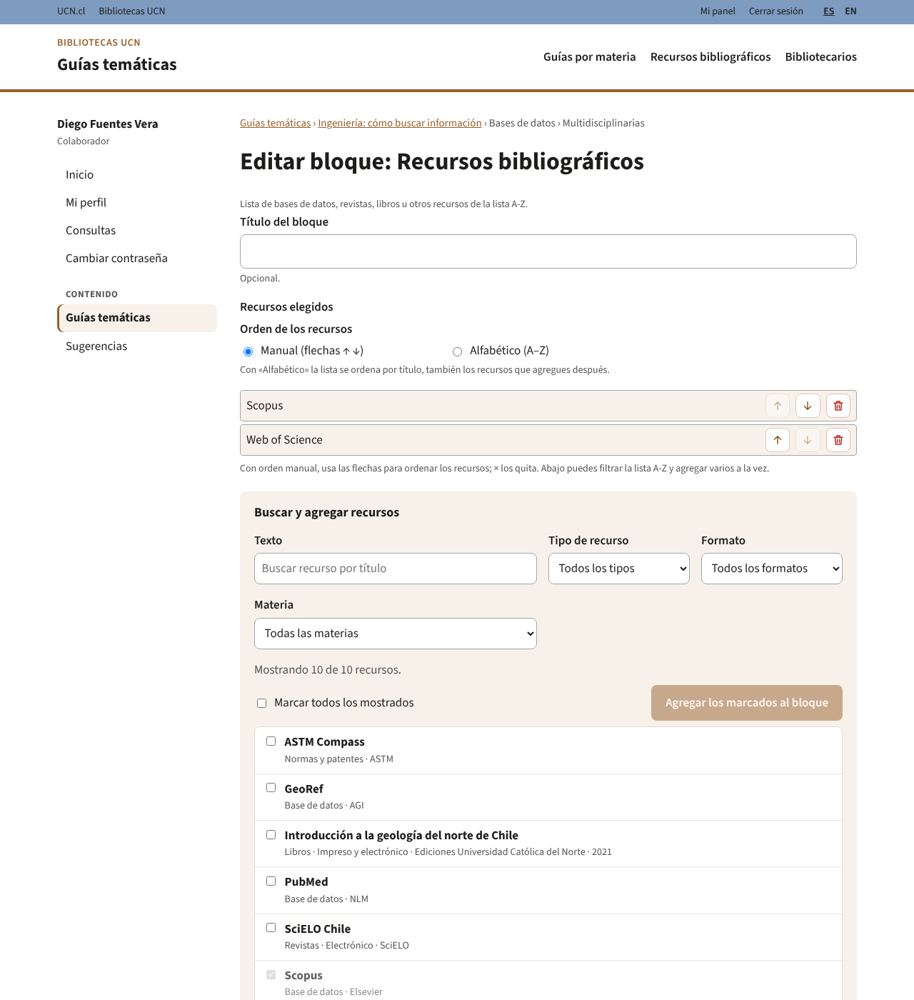

- **Orden de los recursos:** *Manual* (con las flechas ↑ ↓ de cada recurso) o *Alfabético (A–Z)*.
- **Recursos elegidos:** los que ya están en el bloque; ✕ los quita (no los borra de la lista A-Z).
- **Buscar y agregar recursos:** filtra la lista A-Z por texto, tipo, formato y materia, marca los que quieras (o
  **Marcar todos los mostrados**) y presiona **Agregar los marcados al bloque**.

Si el recurso no está en la lista A-Z, pide a un editor que lo agregue, o sugiérelo desde el sitio público.

En la guía publicada, un bloque con más de 20 recursos de dos o más tipos ofrece botones para filtrar por tipo.

### Libros

Lista de libros con portada, autor, editorial y año, enlazados a su registro en el catálogo o a su versión
electrónica.

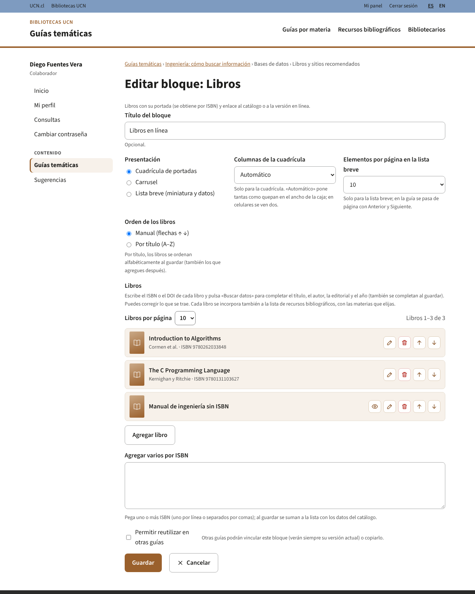

- **Presentación:** cuadrícula de portadas (eliges las columnas), carrusel o lista breve paginada.
- **Orden:** manual o por título A–Z.
- **Agregar libro:** escribe el ISBN (o el DOI) y presiona **Buscar datos**: se completan título, autores, editorial,
  año y portada desde el catálogo Primo o desde doi.org. Lo que escribas a mano tiene prioridad.
- **Agregar varios por ISBN:** pega varios ISBN, uno por línea o separados por comas; al guardar se buscan sus datos.
- **Buscador de libros:** busca en el catálogo (título, autor, editorial) o en **Biblioges** (bibliografía de una
  carrera o asignatura). Marca los resultados y presiona **Agregar los marcados**.
- **Formato** de cada libro: impreso, electrónico o ambos; «Detectar» lo deduce del catálogo.
- **Materias** de cada libro, y el desplegable **Asignar materias a los que agregues** del buscador.

Al guardar, cada libro se incorpora solo a la lista de recursos A-Z como tipo Libros (si ya estaba, se vincula sin
duplicarlo). Quitar un libro del bloque no lo borra de la lista.

**Ejemplo.** Para la pestaña «Libros» de Ingeniería: en el buscador eliges **Biblioges**, la carrera Ingeniería Civil,
bibliografía **básica**, **disponible** y «solo la última edición»; marcas los resultados, eliges la materia
«Ingeniería civil» en **Asignar materias a los que agregues**, presionas **Agregar los marcados** y luego **Guardar**.

### Revistas

Igual que Libros, para revistas: a mano, por ISSN o desde la búsqueda de revistas del catálogo Primo (por título o por
categoría: área, subárea y especialidad). También acepta pegar un enlace de una búsqueda de revistas de Primo. Las
revistas se incorporan a la lista A-Z como tipo Revistas.

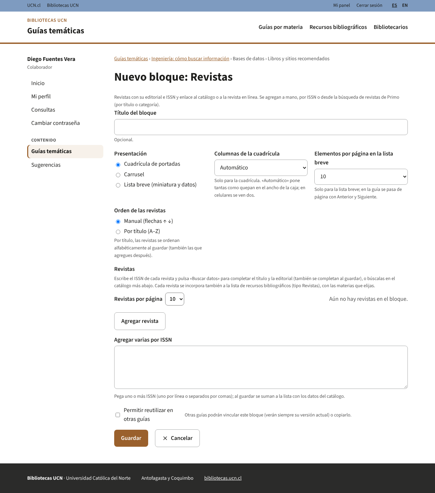

### Lista de enlaces

Sitios web externos, cada uno con texto, dirección y descripción opcional. La casilla **Agregar a recursos
bibliográficos (lista A-Z)** crea (o vincula, si la dirección ya existe) un recurso de tipo Sitio web, de acceso
abierto y con las materias de la guía.

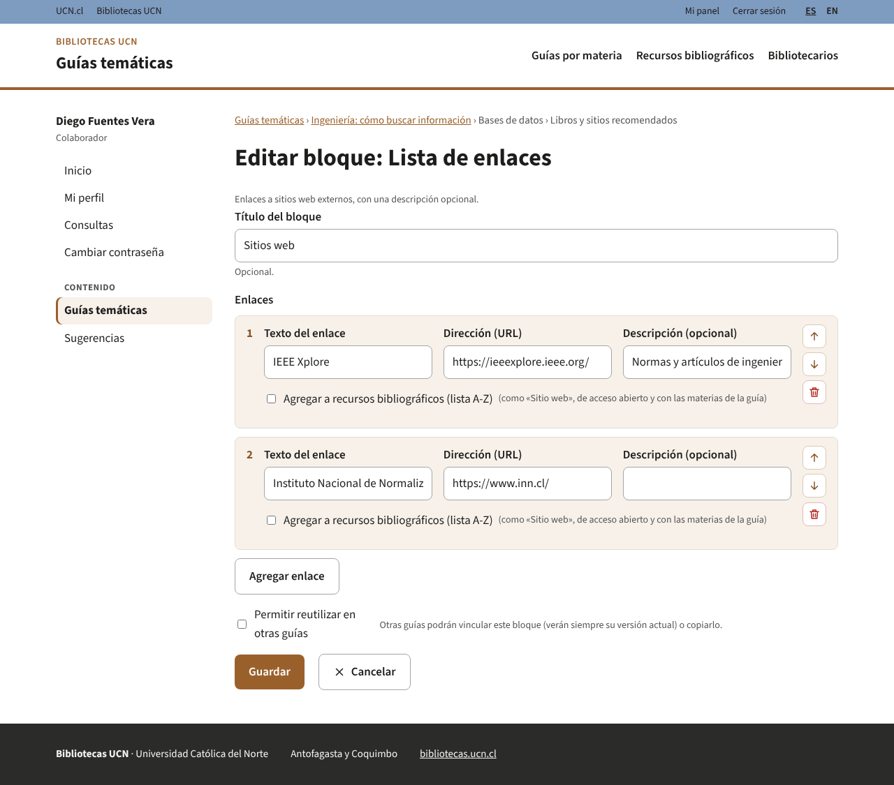

### Perfil del bibliotecario

Tarjeta de contacto de una persona del directorio: foto, cargo, correo, ubicación y botón para agendar una cita.

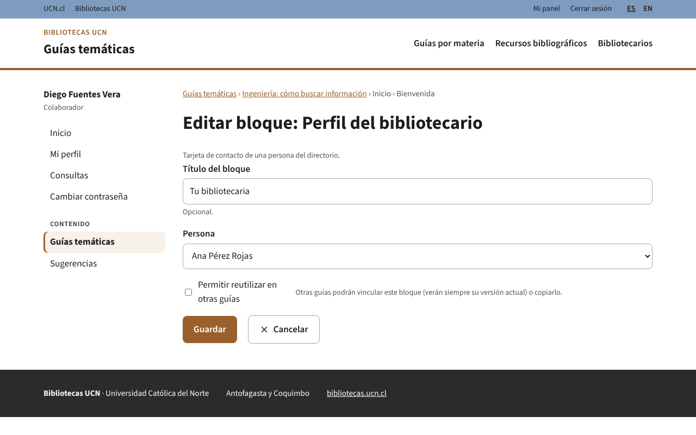

### Video

Pega el enlace de YouTube o Vimeo y, si quieres, una descripción. YouTube se muestra en modo de privacidad mejorada.

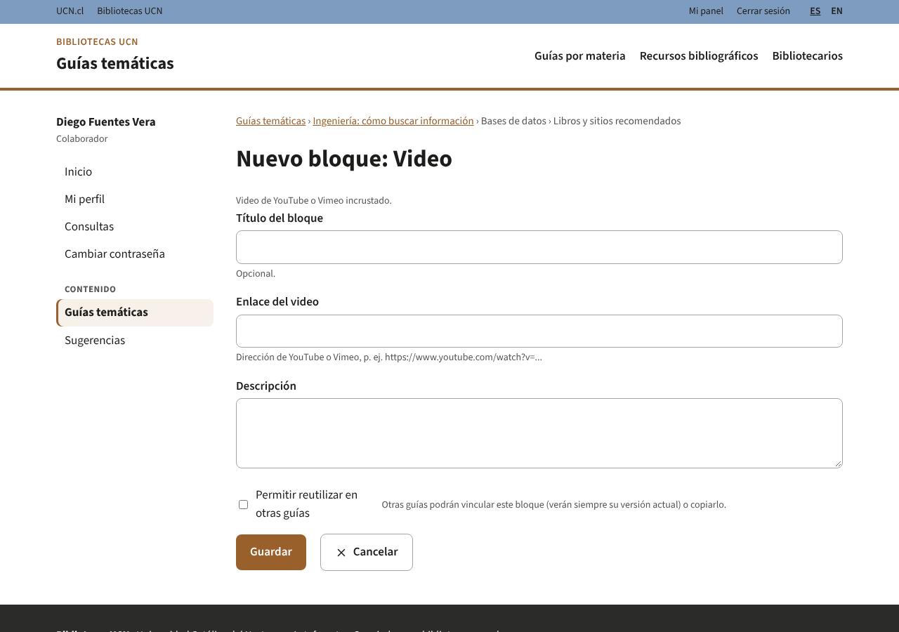

### Búsqueda en el catálogo

Caja de búsqueda que envía la consulta al catálogo Primo VE, con un texto de ayuda opcional.

### Diapositivas

Carrusel de imágenes que se van pasando. Cada imagen puede llevar un texto y un enlace. Sube imágenes JPG, PNG o
WebP con **Agregar diapositiva**.

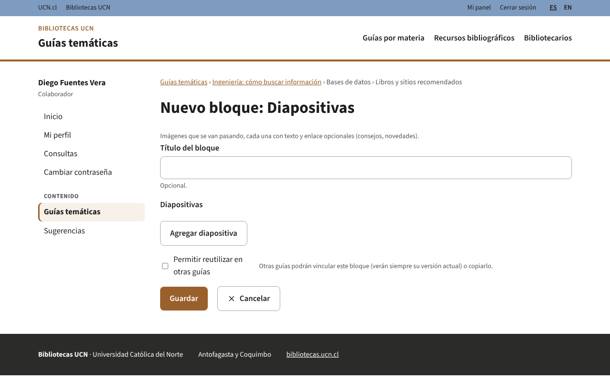

## 3.5 Mover e incrustar un bloque

**Mover** permite elegir la guía, la pestaña y la sección de destino, y si el bloque va al final o al principio.

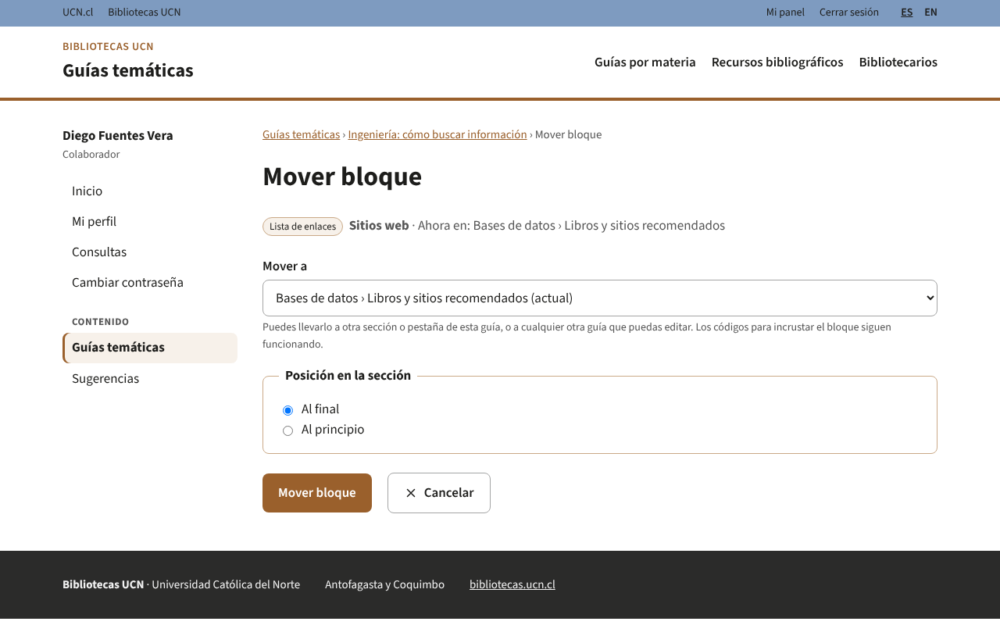

**Incrustar** entrega dos códigos para mostrar el bloque en otra página web (solo funciona con guías publicadas y
públicas): el recomendado, que ajusta el alto solo, y un `<iframe>` para sitios que no aceptan scripts. Debajo se
ve cómo quedará.

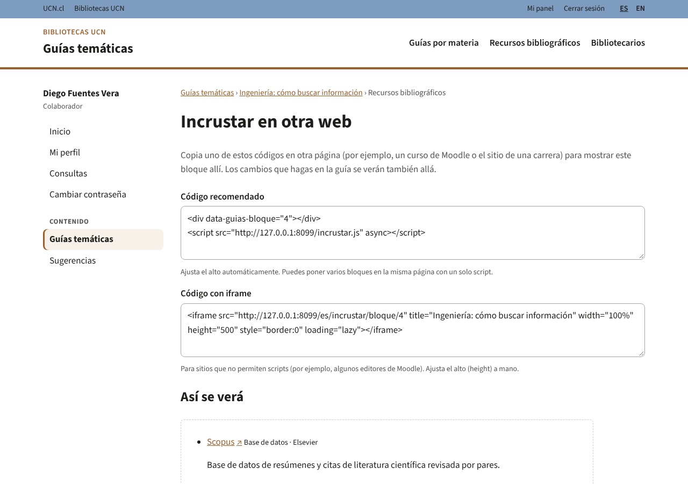

**Ejemplo.** Un docente quiere mostrar en su curso de Moodle el bloque «Multidisciplinarias». En **Incrustar**
copias el «Código con iframe» y se lo envías; él lo pega en una etiqueta de texto de Moodle en modo HTML.

## 3.6 Reutilizar contenido de otras guías

Para no repetir lo mismo en varias guías (bases multidisciplinarias, normas de citación, horarios), un bloque o una
pestaña marcados como **Permitir reutilizar en otras guías** se pueden agregar a otra guía:

- En una sección, **Agregar bloque → Bloque de otra guía**.
- En la barra de pestañas, **Pestaña de otra guía**.

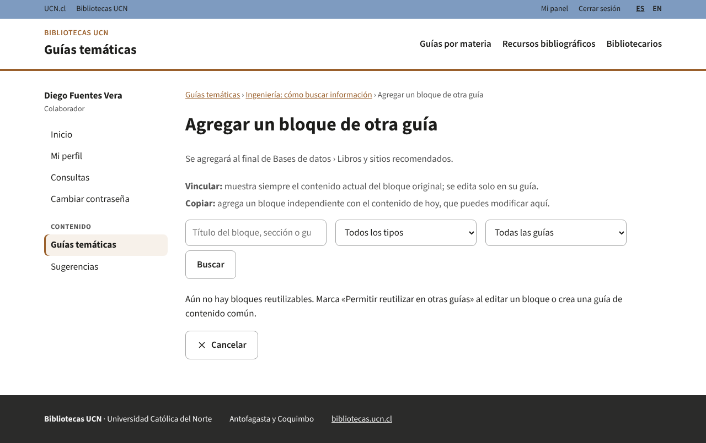

Hay dos formas de agregarlo:

| Forma | Resultado |
| ------------ | ---------------------------- |
| **Vincular** | Muestra siempre el contenido actual del original. Solo se edita en la guía original; en esta aparece como vínculo |
| **Copiar** | Crea una copia independiente que puedes cambiar sin afectar al original |

Un vínculo puede pasar a ser copia con **Convertir en copia propia**. Si alguien elimina un original que tiene
vínculos, la plataforma avisa qué guías lo usan, y esos vínculos se borran con él.

El administrador puede mantener una guía de **contenido común**, que no se publica y cuyos bloques y pestañas están
siempre disponibles para reutilizar (ver [5.9](05-administrador.md#59-guías-de-todo-el-equipo-y-contenido-común)).

## 3.7 Vista previa

**Vista previa** muestra la guía tal como se verá publicada, incluso si está en borrador. Una franja arriba indica el
estado y lleva de vuelta al editor.

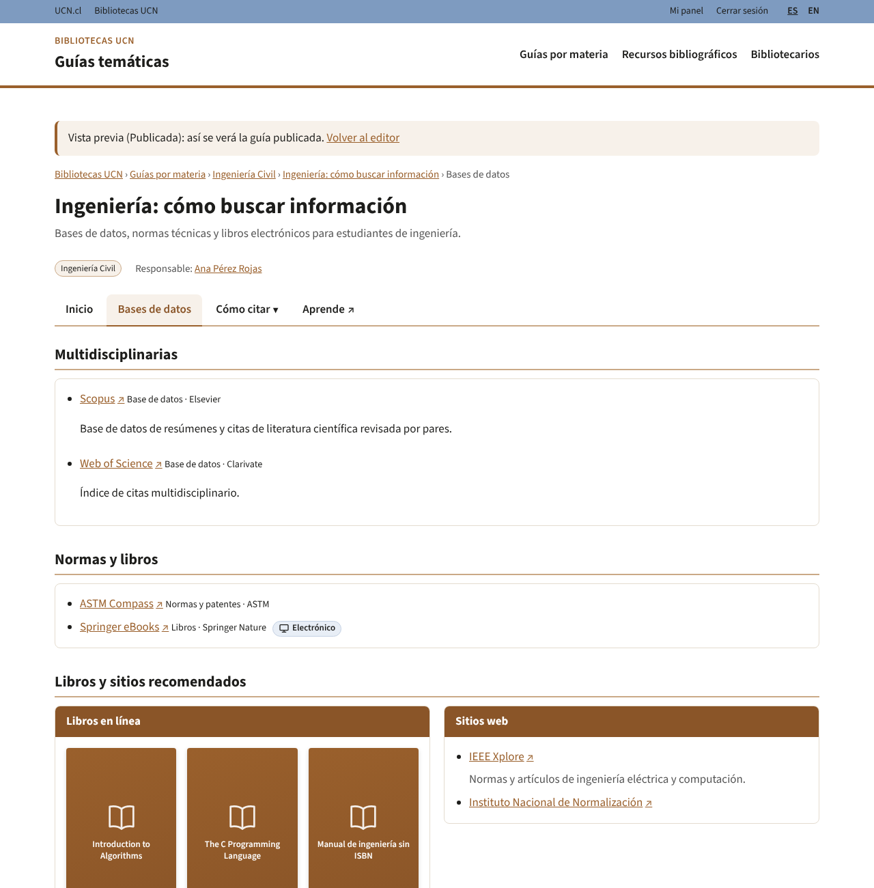

## 3.8 Ejemplo completo: agregar una pestaña «Tesis»

1. En el editor de la guía, escribe «Tesis» en **Nueva pestaña** y presiona **Agregar**.
2. En la sección que se creó, escribe el título «Dónde buscar tesis», elige **2 columnas** y presiona 💾.
3. **Agregar bloque → Texto**: título «Repositorio UCN», un párrafo explicando qué tesis hay y un enlace. **Guardar**.
4. **Agregar bloque → Lista de enlaces**: título «Otros repositorios», agrega «LA Referencia» y «Repositorio
   Institucional de la U. de Chile» con su dirección. **Guardar**.
5. Arrastra la pestaña «Tesis» con su icono ⠿ para dejarla antes de «Cómo citar».
6. Revisa con **Vista previa**. Si la guía ya está publicada, los cambios se ven de inmediato en el sitio.
