# 4. Manual del editor: crear guías y mantener la lista de recursos

Un **editor** crea guías, es su **responsable** y decide quién más las edita. También mantiene la lista de recursos
bibliográficos A-Z, los autores y las editoriales. Hace además todo lo que hace un colaborador
([capítulo 3](03-colaborador.md)).

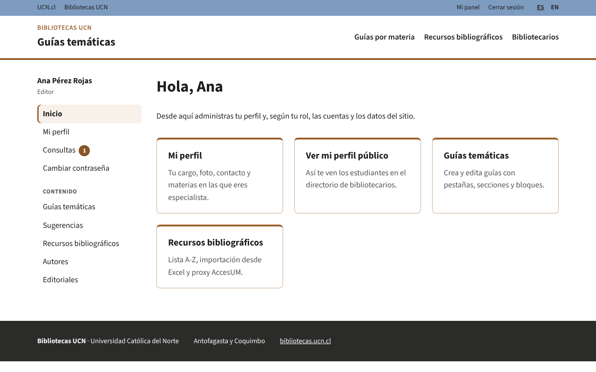

## 4.1 Crear una guía

En **Guías temáticas** hay dos botones:

- **Nueva guía (manual):** crea una guía vacía con una pestaña «Inicio».
- **Nueva guía con IA:** arma una guía completa a partir de las materias (ver 4.5).

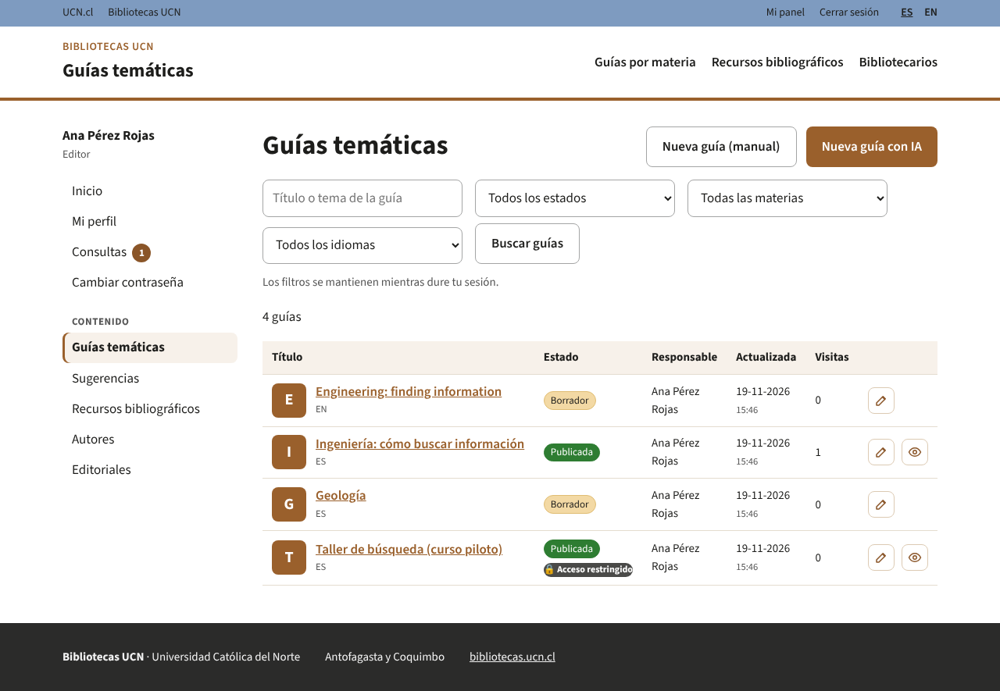

### Datos de la guía

Al crear la guía (y luego con **Datos de la guía** en el editor) se completa este formulario:

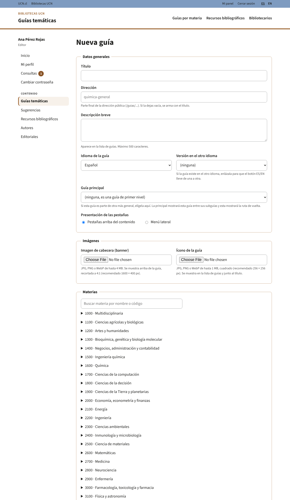

| Campo | Para qué sirve |
| ------------ | ---------------------------- |
| Título | Nombre de la guía |
| Dirección | Parte final de la dirección pública (`/es/guias/…`). Si la dejas vacía se arma con el título. Solo minúsculas sin tildes, números y guiones |
| Descripción breve | Aparece en la lista de guías y en los buscadores (hasta 300 caracteres) |
| Idioma de la guía | Español o inglés |
| Versión en el otro idioma | Enlaza la misma guía en el otro idioma: el botón ES / EN lleva de una a otra |
| Guía principal | Si esta guía es parte de otra más general (por ejemplo, «Química orgánica» dentro de «Química») |
| Presentación de las pestañas | Pestañas arriba del contenido o menú lateral |
| Imagen de cabecera (banner) | JPG, PNG o WebP de hasta 4 MB, recortada a 4:1 (recomendado 1600 × 400 px) |
| Ícono de la guía | Cuadrado, hasta 1 MB (recomendado 256 × 256 px); se ve en la lista de guías |
| Materias | Las de la guía: definen dónde aparece en «Guías por materia», qué sugerencias recibe y las materias de los recursos que se agregan desde ella |
| Coeditores | Personas que pueden editar el contenido, pero no publicar ni cambiar estos datos |
| Visibilidad | **Pública** o **Solo usuarios asignados** |
| Usuarios asignados | Quiénes pueden ver la guía si es restringida |

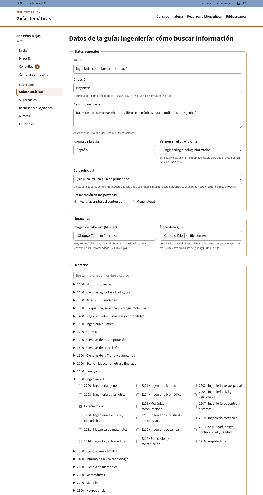

**Ejemplo.** Ana crea la guía «Química»: dirección `quimica`, idioma español, materias «Química (general)» y «Química
orgánica», coeditora Carla (colaboradora del área) y presentación «Menú lateral». Luego crea «Chemistry» en inglés y,
en **Versión en el otro idioma**, enlaza ambas.

### Guías restringidas

Con **Visibilidad: Solo usuarios asignados**, la guía no aparece en la lista pública ni en los buscadores. Al abrir su
dirección se pide iniciar sesión, y solo la ven los usuarios asignados, el responsable, los coeditores y los
administradores. Para alguien que no es del personal (por ejemplo, estudiantes de un curso piloto), el administrador
le crea una cuenta con el rol **Lector**.

### Guías principales y subguías

Si eliges una **Guía principal**, esta guía pasa a ser una subguía: la principal muestra la lista de sus subguías en
su portada, y la subguía muestra «Parte de…» y la ruta completa en las migas de pan.

## 4.2 Publicar, pasar a borrador y eliminar

Toda guía nace en **Borrador**: solo se ve en la vista previa del panel. Con **Publicar** (en la cabecera del editor)
aparece en el sitio; **Pasar a borrador** la retira sin perder nada. Los cambios en una guía publicada se ven de
inmediato.

Para **eliminar** una guía, ve a **Datos de la guía** y usa **Eliminar la guía** al final. Se borran sus pestañas,
secciones y bloques; los recursos de la lista A-Z y los perfiles no se modifican. No se puede deshacer.

Solo el responsable (o un administrador) publica, cambia los datos o elimina la guía.

## 4.3 Lista de recursos bibliográficos A-Z

**Recursos bibliográficos** es la lista maestra de todo lo que se recomienda: bases de datos, revistas, libros,
artículos, normas, repositorios, multimedia, herramientas y sitios web. Lo que se agrega aquí aparece en la lista
pública A-Z y se puede usar en los bloques de las guías.

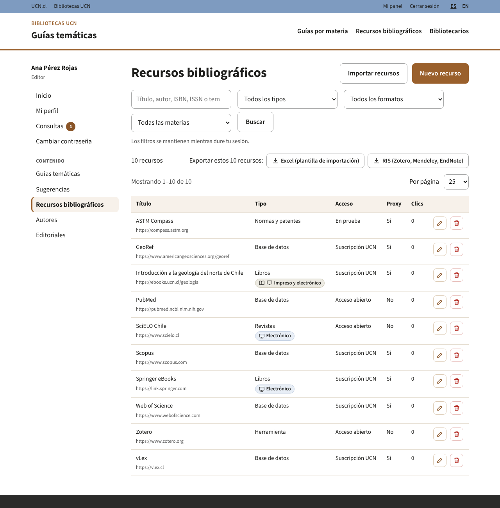

**Filtros.** Texto (título, autor, ISBN, ISSN o tema), tipo, formato y materia. Como en las guías, los filtros, la
página y la cantidad por página **se recuerdan mientras dure la sesión**.

### Crear o editar un recurso

**Nuevo recurso** abre el formulario. Los datos bibliográficos cambian según el tipo elegido.

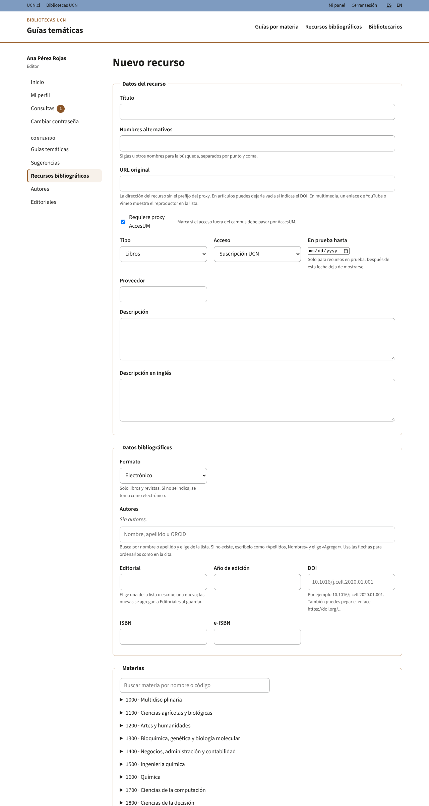

| Campo | Para qué sirve |
| ------------ | ---------------------------- |
| Título y nombres alternativos | Los alternativos (siglas, nombres antiguos) también sirven para buscar |
| URL original | La dirección del recurso **sin** el proxy |
| Requiere proxy AccesUM | Marcado para los recursos suscritos: el enlace público pasa por el proxy y funciona fuera del campus |
| Tipo | Base de datos, Revistas, Artículo científico, Libros, Repositorio, Normas y patentes, Multimedia, Herramienta, Sitio web |
| Acceso | Suscripción UCN, Acceso abierto o En prueba |
| En prueba hasta | Para accesos de prueba: después de esa fecha el recurso deja de mostrarse |
| Proveedor | Plataforma o editor (EBSCO, Elsevier, ProQuest…) |
| Descripción y descripción en inglés | Texto que se ve en la lista A-Z y en los bloques |
| Datos bibliográficos | Según el tipo (ver tabla) |
| Materias | En qué materias aparece |
| Visible | Desmarcado, el recurso se oculta del público sin borrarlo |

| Tipo | Datos bibliográficos |
| ------------ | ---------------------------- |
| Libros | Formato, autores, editorial, año de edición, ISBN, e-ISBN, DOI |
| Revistas | Formato, editorial, ISSN, e-ISSN, disponible desde |
| Artículo científico | Autores, fuente (revista), año, volumen, fascículo, páginas, DOI |
| Base de datos | Disponible desde |
| Normas y patentes | Código de la norma, organismo emisor, año |
| Multimedia | Autores, año (un enlace de YouTube o Vimeo muestra el reproductor) |

Los autores se buscan entre los existentes o se agregan escribiendo «Apellidos, Nombres», y se ordenan como en la
cita. La editorial se elige de la lista o se escribe una nueva. ISBN, ISSN y DOI se validan al guardar.

**Ejemplo.** Para agregar *Web of Science*: tipo **Base de datos**, URL `https://www.webofscience.com`, **Requiere
proxy** marcado, acceso **Suscripción UCN**, proveedor «Clarivate», materias «Multidisciplinaria». En el sitio, el
enlace saldrá como `https://itmsp.museknowledge.com/UCN?qurl=…` y funcionará desde la casa del estudiante.

### Importar desde Excel, BibTeX o RIS

**Importar recursos** carga muchos recursos de una vez desde Excel (.xlsx, .xls), OpenDocument (.ods), CSV, BibTeX
(.bib) o RIS (.ris), hasta 10 MB y 5.000 registros.

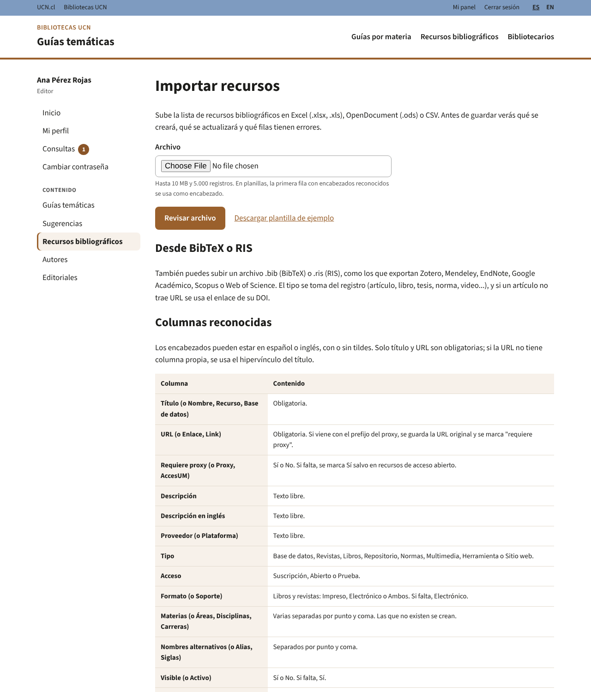

1. Descarga la **plantilla de ejemplo** y complétala (o usa tu propia planilla: los encabezados se reconocen en
   español o inglés, con o sin tildes; solo título y URL son obligatorios).
2. Súbela y presiona **Revisar archivo**.
3. En la **vista previa**, cada fila indica si se creará, se actualizará (ya existe un recurso con la misma URL o
   título) o tiene errores. Puedes desmarcar filas, elegir la URL cuando hay varias, marcar el proxy y ajustar las
   materias.
4. Presiona **Importar** para guardar.

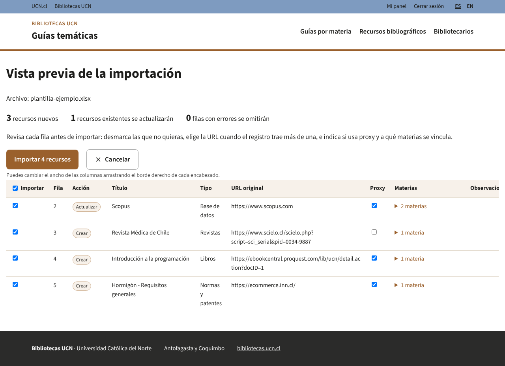

Detalles útiles:

- Si las URL vienen con el prefijo del proxy, la importación lo quita y marca «Requiere proxy».
- En la columna **Materias**, separa varias con punto y coma (`Ingeniería civil; Geología`). La importación no crea
  materias: los nombres que no coinciden se informan para que elijas la categoría.
- Autores en formato «Apellidos, Nombres», separados por punto y coma.
- Los archivos BibTeX y RIS se exportan desde Zotero, Mendeley, EndNote, Google Académico, Scopus o Web of Science.

### Exportar

Sobre la tabla hay dos botones que exportan **los recursos que cumplen los filtros actuales**:

- **Excel (plantilla de importación):** mismas columnas que la plantilla. Sirve para respaldar, revisar o corregir
  datos en bloque y volver a importarlos (al reimportar se actualizan los mismos recursos).
- **RIS (Zotero, Mendeley, EndNote):** para gestores bibliográficos, con autores, año, editorial, ISBN/ISSN, DOI,
  enlace con proxy y materias como palabras clave.

**Ejemplo.** Para corregir los proveedores de todas las bases de datos: filtra por tipo **Base de datos**, exporta a
Excel, corrige la columna Proveedor y vuelve a importar el archivo.

## 4.4 Autores y editoriales

**Autores** y **Editoriales** son tablas propias que usan los recursos.

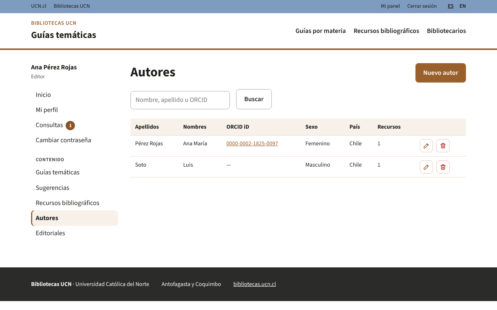

- **Autor:** nombres, apellidos, ORCID iD (se valida), sexo y país. Un autor institucional (por ejemplo «Organización
  Mundial de la Salud») lleva el nombre completo en apellidos.
- **Editorial:** nombre (no se repite) y país.

La columna **Recursos** indica cuántos recursos usan cada uno. Al importar, los autores y editoriales se buscan sin
distinguir mayúsculas ni tildes y se crean solo si no existen.

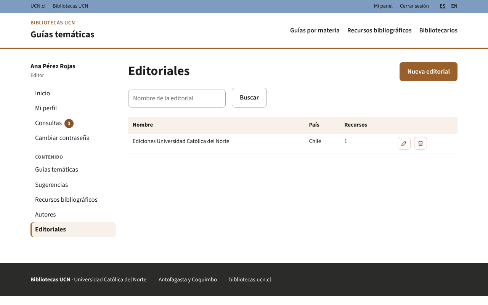

## 4.5 Nueva guía con IA

El asistente arma una guía en borrador con seis pestañas a partir de las materias que elijas: Presentación, Bases de
datos, Revistas, Sitios web, Citación y gestores, y Libros.

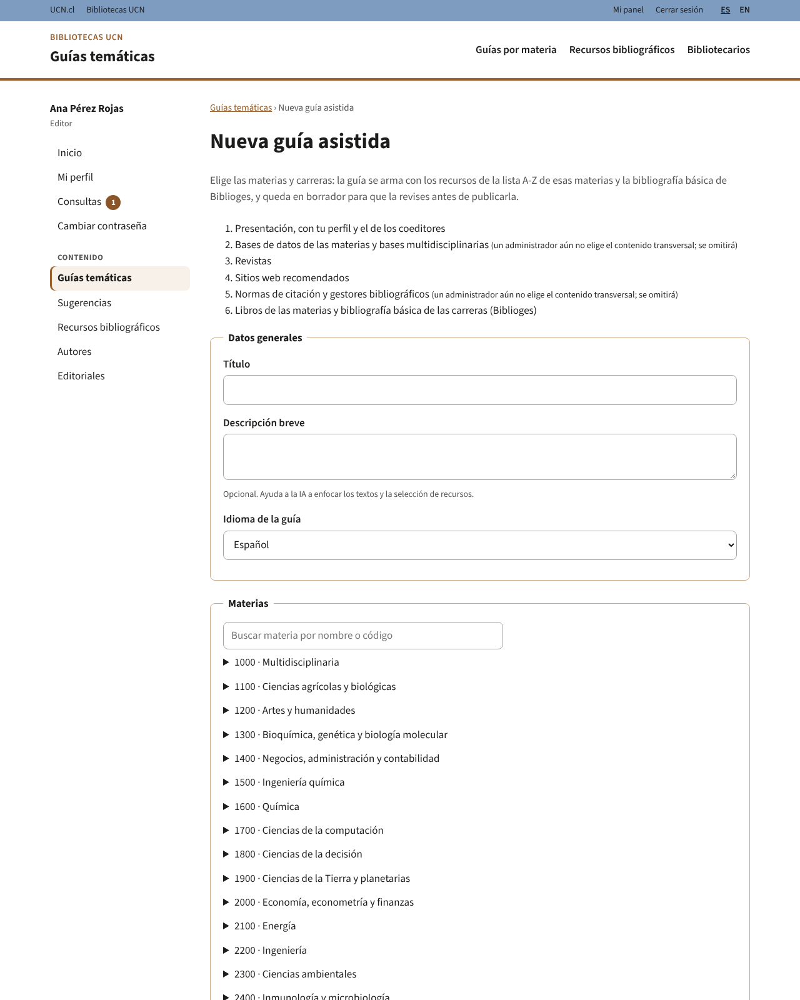

1. Escribe el título, una descripción breve y el idioma.
2. Elige al menos una **materia**: los recursos de la lista A-Z de esas materias llenan las pestañas.
3. Opcional: **coeditores** y hasta 5 **carreras de Biblioges**, cuya bibliografía básica disponible (última edición)
   se agrega a la pestaña Libros y a la lista A-Z.
4. Presiona **Crear la guía**. En unos segundos se abre el editor con la guía armada.

Con la inteligencia artificial (Gemini) configurada, se eligen los recursos más pertinentes, se escriben los textos de
presentación y se proponen sitios web adicionales en un bloque «Sugeridos por IA (revisar)». Esos sitios no entran a
la lista A-Z: revísalos y bórralos o muévelos antes de publicar. Sin IA, la guía se arma igual con todos los recursos
de las materias en orden alfabético.

A Gemini solo se envían las materias, carreras y títulos y descripciones de recursos; nunca datos de personas.

**La guía queda en borrador:** revísala completa, ajusta los textos y publícala cuando esté lista.

## 4.6 Ejemplo completo: guía de Geología de principio a fin

1. **Nueva guía (manual)**: título «Geología», materias «Geología» y «Ciencias de la Tierra y planetarias (general)»,
   coeditor Diego, presentación «Menú lateral». **Guardar**.
2. En **Recursos bibliográficos**, verifica que GeoRef y Scopus tengan la materia Geología; si falta GeoRef, créalo.
3. En el editor, renombra «Inicio» si quieres y agrega una sección con un bloque **Texto** de bienvenida y un bloque
   **Perfil del bibliotecario**.
4. Pestaña «Bases de datos» con un bloque **Recursos bibliográficos**: filtra por materia Geología, marca todos y
   agrégalos en orden alfabético.
5. Pestaña «Libros» con un bloque **Libros** cargado desde Biblioges.
6. Pestaña «Cómo citar»: **Pestaña de otra guía → Vincular** la pestaña común de citación.
7. Revisa con **Vista previa** y presiona **Publicar**.
