# 5. Manual del administrador

El **administrador** gestiona las cuentas, el esquema de materias, la apariencia del sitio y las conexiones con otros
sistemas. Además puede editar todas las guías y hace todo lo que hacen editores y colaboradores
([capítulos 3](03-colaborador.md) y [4](04-editor.md)).

Las opciones propias del administrador están en el grupo **Administración** del menú.

## 5.1 Usuarios

**Usuarios** lista todas las cuentas con su correo, rol, si está activa y el último acceso.

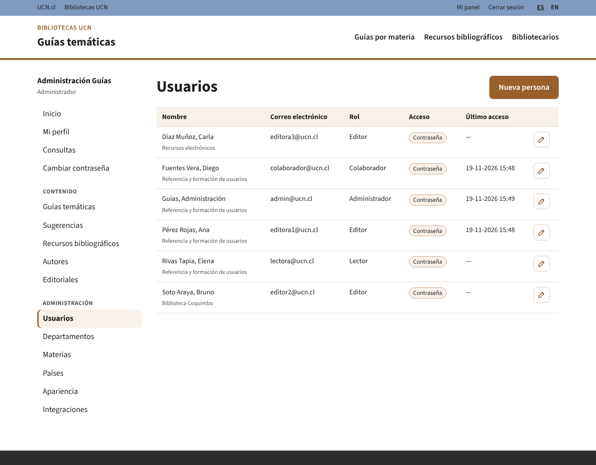

**Nueva persona** abre el formulario:

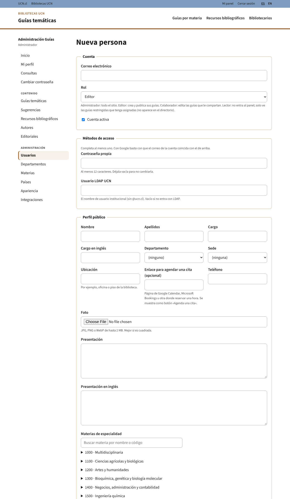

| Grupo | Campos |
| ------------ | ---------------------------- |
| Cuenta | Correo electrónico (con él se identifica), rol, cuenta activa |
| Métodos de acceso | Contraseña propia (mínimo 12 caracteres) y/o usuario LDAP UCN. Para Google basta con que el correo coincida |
| Perfil público | Los mismos datos de [Mi perfil](02-funciones-comunes.md#21-mi-perfil), que la persona luego puede completar |

- **Roles:** Administrador (todo el sitio), Editor (crea y publica sus guías), Colaborador (edita las guías que le
  compartan) y Lector (no entra al panel; solo ve las guías restringidas que tenga asignadas).
- **Dar de baja a alguien:** desmarca **Cuenta activa**. La persona ya no puede entrar, pero sus guías, consultas y
  revisiones conservan su nombre.
- **Olvidó su contraseña:** edita la cuenta y escribe una nueva en **Contraseña propia**; comunícasela por un canal
  seguro y pídele que la cambie en **Cambiar contraseña**.

**Ejemplo.** Llega Javiera, nueva bibliotecaria de Coquimbo. Creas su cuenta con su correo `@ucn.cl`, rol **Editor**,
usuario LDAP `jperez` (entrará con su clave institucional), departamento «Biblioteca Coquimbo» y sede Coquimbo. Ella
completa su foto y materias en **Mi perfil**.

## 5.2 Departamentos

Agrupan al personal en el directorio de bibliotecarios (por ejemplo, «Referencia y formación de usuarios»). Cada
departamento tiene nombre, sede y un **orden** que define su posición en el directorio.

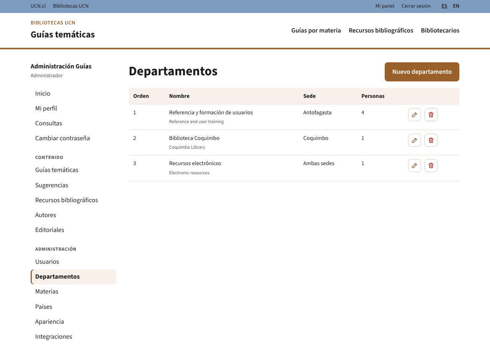

## 5.3 Materias y categorías ASJC

El esquema de materias se basa en las **334 categorías ASJC** de Scopus, agrupadas en 27 campos y 5 grandes áreas.
Vienen cargadas y no se pueden eliminar (sí desactivar). Sobre ellas se crean **materias propias** (carreras,
asignaturas, líneas de investigación), que deben quedar **clasificadas** en al menos una categoría ASJC.

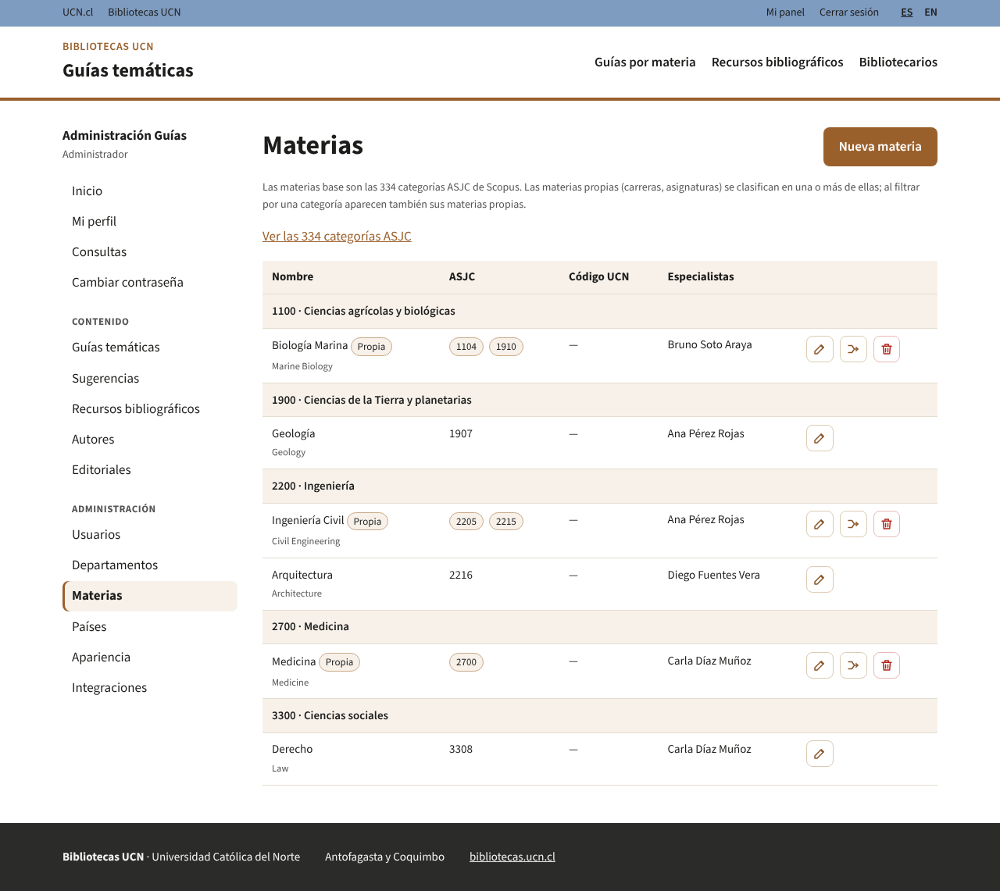

El listado muestra las materias propias y las categorías en uso, agrupadas por campo; **Ver las 334 categorías ASJC**
las muestra todas. Si hay materias propias sin clasificar, aparece un aviso.

Al filtrar por una categoría ASJC en el sitio (guías, lista A-Z, directorio), aparecen también los recursos y guías de
las materias propias clasificadas en ella.

### Crear una materia propia

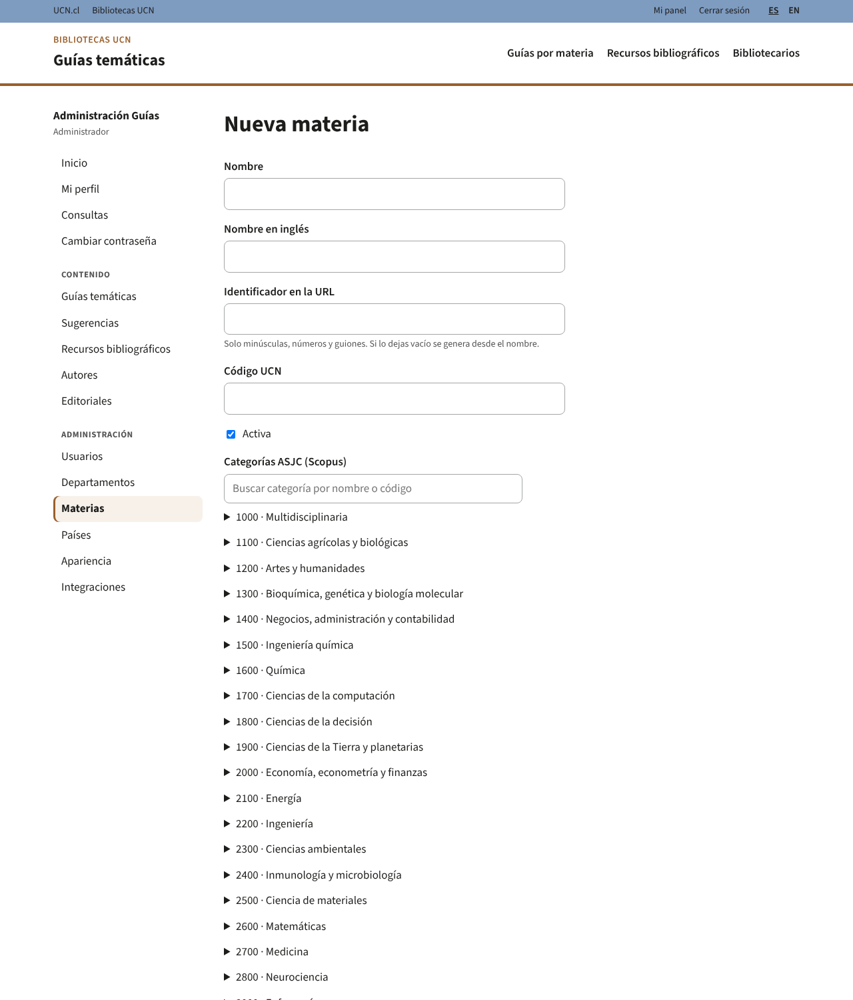

| Campo | Para qué sirve |
| ------------ | ---------------------------- |
| Nombre y nombre en inglés | Cómo se muestra en cada idioma |
| Identificador en la URL | Se usa en los filtros (`?materia=…`); si lo dejas vacío se arma con el nombre |
| Código UCN | Opcional, el código interno de la carrera o asignatura |
| Activa | Desmarcada, la materia deja de ofrecerse en los formularios y filtros |
| Categorías ASJC | Al menos una. Usa el buscador por nombre o código |

**Ejemplo.** Para la carrera «Ingeniería Civil en Obras Civiles»: nombre en inglés «Civil Engineering», el código
UCN de la carrera y las categorías **2205 Ingeniería civil y estructural** y **1909 Ingeniería geotécnica y geología
aplicada** (en el buscador basta escribir «civil» o «2205»). Al filtrar por «Ingeniería civil y estructural» en la
lista A-Z aparecerán también los recursos de esta carrera.

### Homologar una materia propia

Si una materia propia equivale exactamente a una categoría ASJC, **Homologar** la reemplaza: sus recursos, guías,
especialistas, sugerencias y bloques de búsqueda pasan a la categoría y la materia propia se elimina. Antes de
confirmar se muestra cuántos elementos cambian.

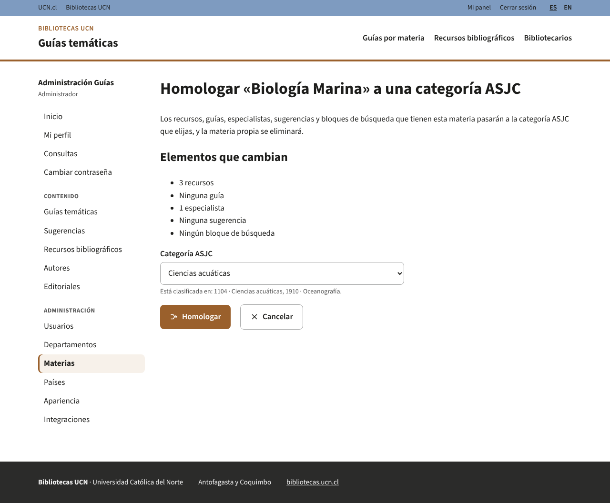

### Eliminar una materia propia

**Eliminar** abre una página con lo que usa la materia y el campo **Reasignar a**: elige otra materia (propia o
categoría ASJC) para que reciba sus recursos, guías, especialistas, sugerencias y bloques, o **No reasignar** para
solo quitarla. La plataforma propone la categoría ASJC en que estaba clasificada. Esta acción no se puede deshacer.

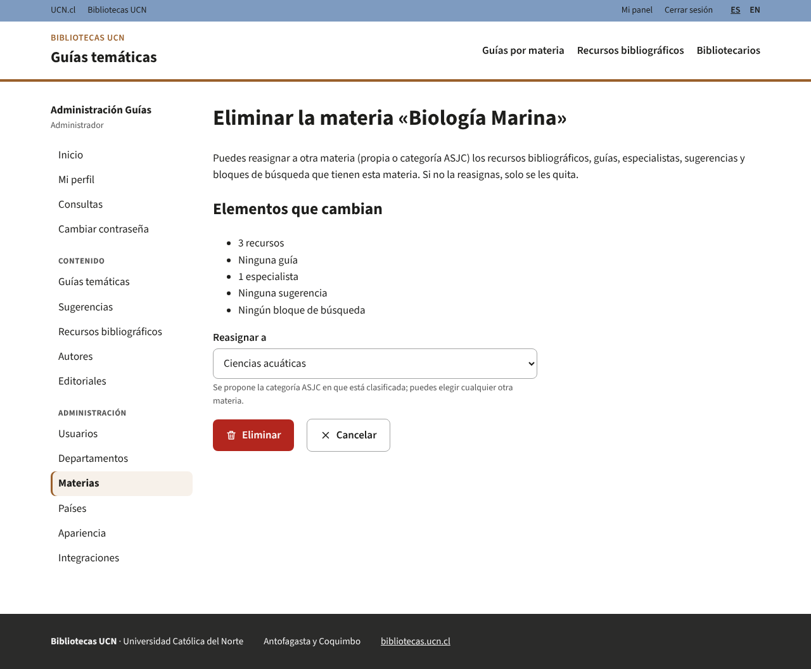

## 5.4 Países

Tabla ISO 3166-1 de países (nombre en español e inglés) que usan autores y editoriales. **Completar lista ISO**
repone los que falten.

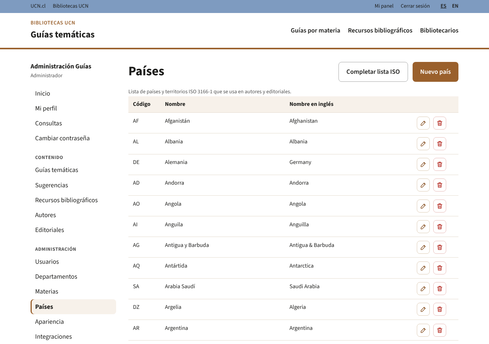

## 5.5 Apariencia

Personaliza el sitio sin tocar código. Lo que se deja vacío usa el tema de Bibliotecas UCN.

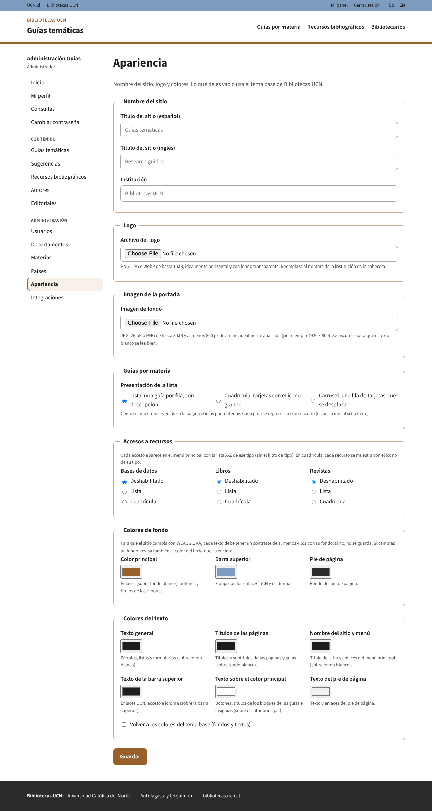

| Grupo | Qué se define |
| ------------ | ---------------------------- |
| Nombre del sitio | Título en español e inglés, e institución |
| Logo | Imagen de la cabecera (PNG, JPG o WebP, mejor horizontal y con fondo transparente) |
| Imagen de la portada | Fondo de la portada (recomendado 1920 × 600 px o más) |
| Guías por materia | Presentación de la lista de guías: lista, cuadrícula de tarjetas o carrusel |
| Accesos a recursos | Para Bases de datos, Libros y Revistas: deshabilitado, lista o cuadrícula. Cada acceso habilitado aparece en el menú principal con su propia página |
| Colores de fondo | Principal, barra superior y pie de página |
| Colores de texto | General, títulos, cabecera, barra, botones y pie |

Cada combinación de color de texto y fondo se valida con el contraste mínimo de accesibilidad (WCAG AA) antes de
guardar: si un par no cumple, se indica cuál y no se guarda.

## 5.6 Guías por materia en la portada

La sección «Guías por materia» del sitio muestra solo guías publicadas y públicas. El filtro **Gran área** (Ciencias de
la salud, de la vida, físicas, sociales y humanidades, multidisciplinaria) aparece solo con áreas que tienen
contenido.

## 5.7 Integraciones

**Integraciones** reúne los datos de conexión con servicios externos. Lo que se deja vacío usa la configuración del
servidor (archivo `.env.local`, que administra el encargado de sistemas). Las claves se guardan cifradas y nunca se
vuelven a mostrar: para cambiar una, escribe la nueva.

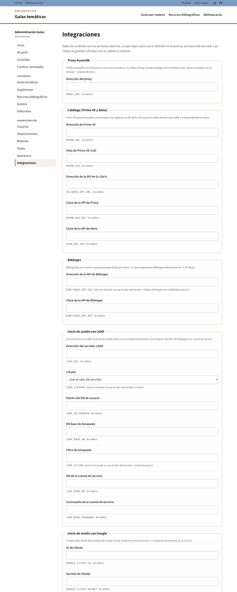

| Grupo | Para qué sirve | Quién entrega los datos |
| ---------- | ------------------------- | --------------- |
| Proxy AccesUM | Prefijo o plantilla con `{url}` para abrir los recursos suscritos desde fuera del campus | Proveedor del proxy |
| Catálogo (Primo VE y Alma) | Búsqueda en el catálogo, datos de libros y revistas por ISBN/ISSN y disponibilidad de ejemplares | Administrador de Alma / Ex Libris |
| Biblioges | Bibliografía de carreras y asignaturas en el bloque Libros y en el asistente | Administrador de Biblioges (Administración → API Keys) |
| LDAP | Inicio de sesión con la cuenta institucional | Unidad de informática de la UCN |
| Google | Inicio de sesión con Google (ID de cliente OAuth) | Consola de Google Cloud de la institución |
| Correo (SMTP) | Avisos de consultas a bibliotecarios. El botón **Enviar correo de prueba** comprueba la configuración | Unidad de informática |
| Inteligencia artificial (Gemini) | Asistente «Nueva guía con IA» | Cuenta de Google AI Studio |
| Moodle (LTI 1.3) | Agregar guías a los cursos de Moodle | Administrador de Moodle |

En la misma página se descarga el **plugin de WordPress** ya configurado con la dirección del servidor.

**Ejemplo.** Para activar el correo: en **Correo (SMTP)** escribe el servidor, el puerto (por ejemplo 587), el cifrado
(STARTTLS), el usuario y la clave, y el remitente `biblioteca@ucn.cl` con nombre «Bibliotecas UCN». Guarda y presiona
**Enviar correo de prueba**: debe llegarte un mensaje a tu correo.

> Nunca compartas por correo ni en documentos las claves de las integraciones: se escriben solo en esta página.

## 5.8 Conexión con otros sistemas

### Moodle

La plataforma funciona como **herramienta externa LTI 1.3** de Moodle. El administrador de Moodle la registra con
estas direcciones del servidor: inicio de sesión `/lti/login`, lanzamiento `/lti/lanzar`, Deep Linking
`/lti/vincular` y llaves públicas `/lti/jwks`. Los datos que entrega Moodle al registrarla se escriben en el grupo
**Moodle (LTI 1.3)** de Integraciones. Después, cada docente agrega «Guías temáticas» como actividad de su curso,
elige la guía, y sus estudiantes la abren desde el curso.

### WordPress

El plugin de WordPress (se descarga desde Integraciones) agrega códigos cortos al sitio de Bibliotecas:

| Código | Muestra |
| ------------ | ---------------------------- |
| `[guias_ucn]` | La lista de guías |
| `[guia_ucn slug="ingenieria"]` | Una guía |
| `[guia_ucn_bloque id="12"]` | Un bloque |
| `[recursos_ucn]` | La lista de recursos A-Z |

Solo muestra contenido público.

### Incrustar bloques y API pública

Cualquier bloque de una guía publicada y pública se puede mostrar en otra web con **Incrustar**
([3.5](03-colaborador.md#35-mover-e-incrustar-un-bloque)). Para desarrolladores hay una API de solo lectura en JSON:
`/api/v1/guias`, `/api/v1/guias/{dirección}` y `/api/v1/recursos`.

## 5.9 Guías de todo el equipo y contenido común

El administrador ve y edita **todas** las guías. En **Datos de la guía** puede además:

- cambiar el **Responsable** (por ejemplo, cuando alguien deja la biblioteca);
- marcar la guía como **Guía de contenido común**: no se publica, y todos sus bloques y pestañas quedan disponibles
  para vincular o copiar en las demás guías (bases multidisciplinarias, normas de citación, horarios…).

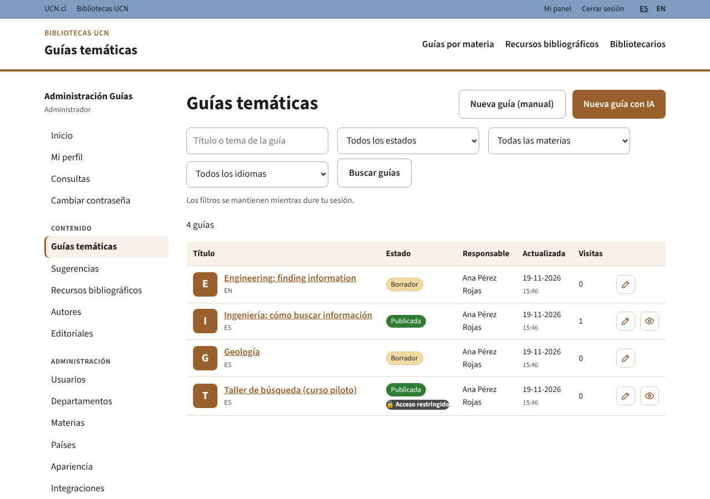

Al final de la página del asistente «Nueva guía con IA», el administrador elige el bloque transversal de bases
multidisciplinarias y la pestaña transversal de citación que el asistente vincula en cada guía nueva.

**Ejemplo.** Crea la guía «Contenido común», márcala como de contenido común y agrega una pestaña «Cómo citar» con
bloques de APA, IEEE y Vancouver. En el asistente, elígela como pestaña de citación. Desde entonces cada guía nueva la
incluye como vínculo, y un cambio en la original se ve en todas.

## 5.10 Respaldos y servidores

Los respaldos diarios, las actualizaciones de versión y el paso de datos entre servidores (pruebas, piloto,
producción) los hace el encargado de sistemas con los scripts de la carpeta `scripts/` del repositorio
(`respaldar.sh`, `restaurar.sh`, `desplegar.sh`). Están descritos en el `README.md` del repositorio.
