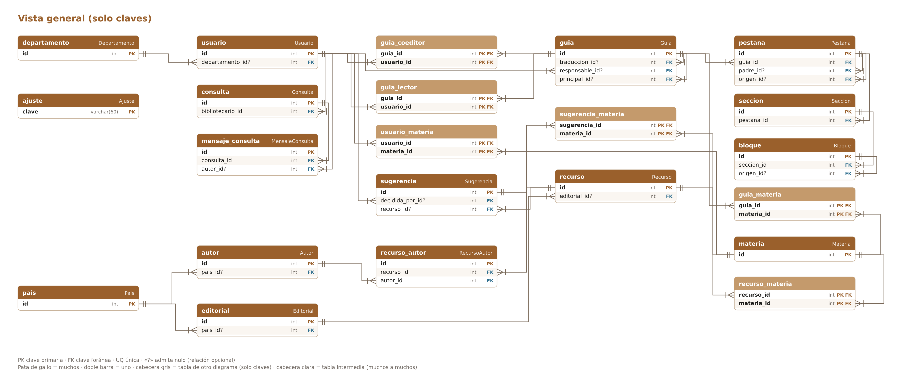
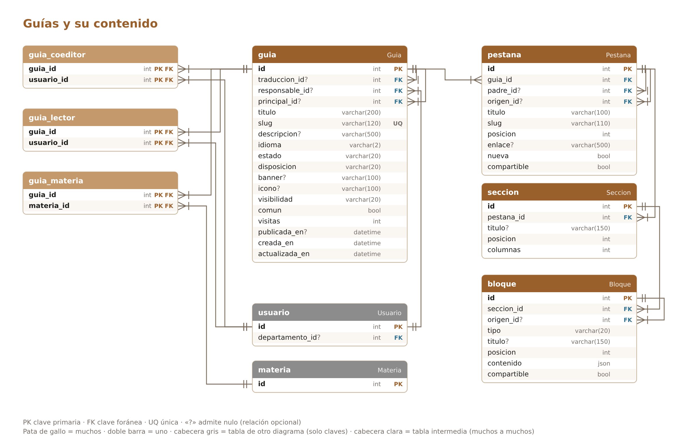
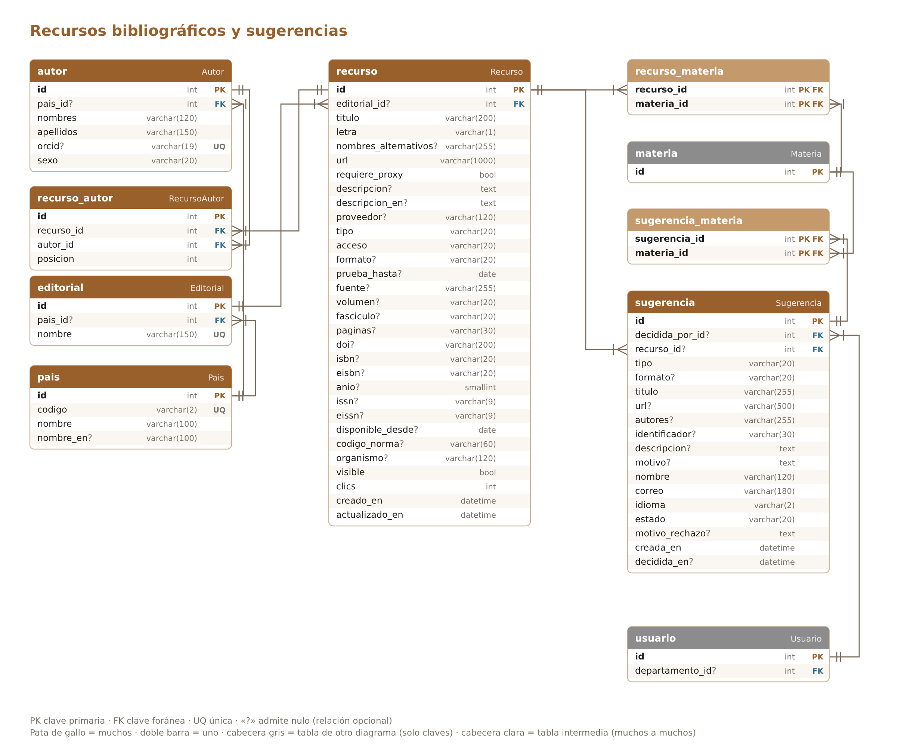
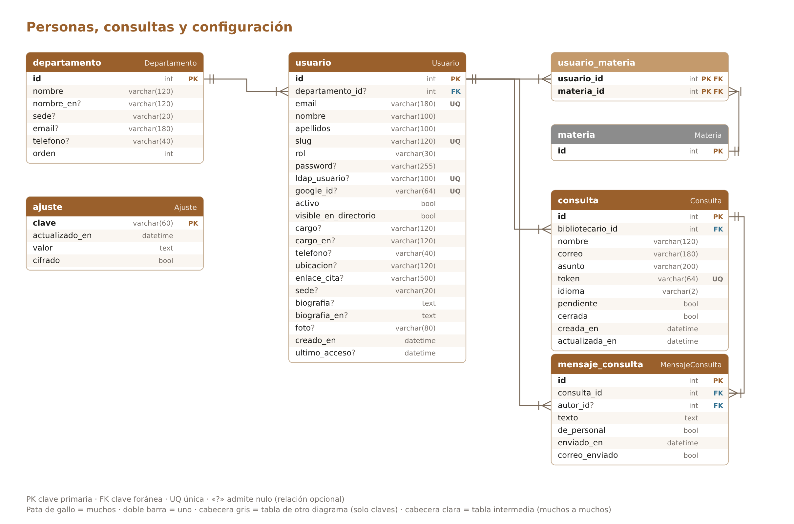

# 2. Modelo de datos

La base de datos (MySQL 8.4, `utf8mb4_unicode_ci`) tiene 22 tablas: 16 entidades de Doctrine y 6 tablas intermedias
de relaciones muchos a muchos. El esquema lo definen las entidades de `src/Entity` y lo crean las migraciones de
`migrations/`; el detalle de cada columna está en el [capítulo 4](04-diccionario-de-datos.md).

## 2.1 Diagrama entidad-relación

Los diagramas se generan desde las entidades con `scripts/generar-diagrama-er.py`, así que siempre corresponden al
código. Las versiones vectoriales (SVG) están en `docs/tecnico/img/`.

**Cómo leerlos.** Cada caja es una tabla, con sus columnas, tipo y claves (PK primaria, FK foránea, UQ única). Un «?»
indica que la columna admite nulo; en una clave foránea, que la relación es opcional. Las líneas unen la clave foránea
(lado «muchos», pata de gallo) con la clave primaria de la tabla referida (lado «uno», doble barra). Las cabeceras
claras son tablas intermedias y las grises, tablas de otro diagrama que se muestran solo con sus claves.

### Vista general

Todas las tablas, solo con sus claves.



### Guías y su contenido

Una **guía** tiene **pestañas**; cada pestaña, **secciones**; cada sección, **bloques**. Las guías se relacionan con
el **usuario** responsable, los coeditores y los lectores asignados, y con sus materias.



### Recursos bibliográficos y sugerencias

La lista A-Z (**recurso**) con sus **autores** (en orden, por `recurso_autor`), **editorial**, **país** y materias.
Una **sugerencia** del público, al aprobarse, queda enlazada al recurso que creó.



### Personas, consultas y configuración

El personal (**usuario**) con su **departamento** y materias de especialidad; las **consultas** que recibe y sus
**mensajes**; y los **ajustes** del sitio (tabla sin relaciones).



## 2.2 Reglas del modelo

### Guías

- `guia.slug` es único y forma la dirección pública `/{idioma}/guias/{slug}`. `pestana.slug` se calcula del título y no se
  repite dentro de la guía (lo controla la entidad, no un índice).
- `guia.estado`: `borrador` o `publicada` (`publicada_en` guarda la primera publicación). `guia.visibilidad`:
  `publica` o `restringida`; las restringidas solo las ven `guia_lector`, el responsable, los coeditores y los
  administradores (`GuiaVoter`).
- Autorreferencias de `guia`: `traduccion_id` (la misma guía en el otro idioma; se mantiene en ambos sentidos) y
  `principal_id` (subguía de otra guía; el formulario impide ciclos).
- `guia.comun = 1` marca una guía de contenido común: no se publica y todo su contenido es reutilizable.
- `pestana.padre_id` permite subpestañas de un nivel. Una pestaña con `enlace` no tiene contenido: lleva a esa URL.
- `posicion` ordena pestañas, secciones y bloques dentro de su contenedor.
- Al eliminar una guía se borran en cascada sus pestañas, secciones y bloques (clave foránea `ON DELETE CASCADE`).

### Contenido compartido (vínculos)

`pestana.origen_id` y `bloque.origen_id` convierten una pestaña o un bloque en un **vínculo** a otro de otra guía: el
vínculo no guarda contenido propio y muestra el del original (`App\Servicio\ContenidoCompartido`). Si se borra el
original, se borran sus vínculos (cascada); el panel avisa antes y ofrece «Convertir en copia propia». Solo se ofrecen
para vincular los elementos con `compartible = 1` y todos los de una guía común.

### Recursos y materias

- `recurso.url` guarda la dirección original; si `requiere_proxy = 1`, el enlace público se arma con la plantilla
  `PROXY_URL` (`App\Servicio\ProxyAccesum`). La importación quita el prefijo del proxy si viene incluido.
- `recurso.letra` se calcula del título y alimenta el índice A-Z.
- Los libros y revistas agregados en los bloques Libros y Revistas se incorporan solos como recursos (el ítem del
  bloque guarda el `id` del recurso en `contenido.items[].recurso`).
- **Materias:** las 334 categorías ASJC de Scopus son filas de `materia` con `codigo_asjc` (únicas, no se eliminan;
  las crea la migración `Version20261119150000` y `app:materias-asjc`). Las materias propias tienen
  `codigo_asjc = NULL` y se clasifican en una o más categorías en `materia.asjc` (lista JSON de códigos). Al filtrar
  por una categoría se incluyen las materias propias clasificadas en ella. Homologar o eliminar una materia propia
  reasigna sus relaciones (`HomologadorMaterias`).

### Personas y consultas

- `usuario.email` es único y es el identificador para entrar. `password` es nulo si la persona entra solo por LDAP
  (`ldap_usuario`) o Google (`google_id`, que se completa en el primer acceso con el correo registrado).
- Dar de baja = `activo = 0`; no se borran filas, para conservar la autoría.
- El panel no borra usuarios. Si se borrara una fila a mano, sus guías quedarían sin responsable (`SET NULL`) y
  sus consultas se borrarían (cascada).
- `consulta.token` es un valor aleatorio de 64 caracteres que da acceso a la conversación sin cuenta.

### Ajustes

`ajuste` es una tabla clave-valor (`clave` es la PK) con los datos de Apariencia e Integraciones. Si `cifrado = 1`,
`valor` está cifrado con sodium usando una clave derivada de `APP_SECRET`: al restaurar en un servidor con otro
`APP_SECRET`, esos valores se descartan (`scripts/restaurar.sh` los borra) y hay que volver a escribirlos.

## 2.3 Contenido de los bloques (`bloque.contenido`)

`bloque.contenido` es JSON y su forma depende de `bloque.tipo`. Lo arma `GuiaController::contenido()` al guardar y lo
lee `App\Servicio\BloquesGuia` al mostrar.

| Tipo | Contenido |
| ------------ | ---------------------------- |
| `texto` | `{"html": "<p>…</p>"}` (HTML saneado) |
| `recursos` | `{"ids": [12, 5, …], "descripcion": true, "orden": "manual"\|"titulo"}` (ids de `recurso`) |
| `perfil` | `{"usuario": 3}` (id de `usuario`) |
| `video` | `{"url": "https://youtu.be/…", "descripcion": "…"}` |
| `busqueda` | `{"texto": "…", "tipo": "todos"\|"libros"\|"tesis"\|"articulos"\|"revistas", "materias": [ids], "otras": false}` (buscador del catálogo) |
| `enlaces` | `{"items": [{"titulo", "url", "descripcion", "en_recursos": bool, "recurso": id\|null}]}` |
| `libros` | `{"presentacion": "cuadricula"\|"carrusel"\|"lista", "columnas": 0\|2…6, "por_pagina": 0\|5\|10\|15\|20, "orden": "manual"\|"titulo", "items": [{"recurso", "titulo", "autor", "isbn", "doi", "editorial", "anio", "enlace", "formato", "registro" (Primo), "mms" (Alma)}]}` |
| `revistas` | Igual que `libros`, con `issn` y `eissn` en vez de autor, ISBN y DOI |
| `diapositivas` | `{"items": [{"imagen": "archivo.webp", "titulo", "enlace"}]}` (imágenes en `public/uploads/guias`) |

Ejemplo de un bloque `recursos` ordenado alfabéticamente:

```json
{"ids": [41, 7, 19], "descripcion": true, "orden": "titulo"}
```

## 2.4 Archivos fuera de la base de datos

| Carpeta | Contenido | Columna que lo nombra |
| ------------ | ---------------------------- | ------------ |
| `public/uploads/personal` | Fotos del personal | `usuario.foto` |
| `public/uploads/guias` | Banners, íconos y diapositivas de las guías | `guia.banner`, `guia.icono`, `bloque.contenido` |
| `public/uploads/sitio` | Logo e imagen de portada | `ajuste` (`LOGO`, `IMAGEN_PORTADA`) |

`scripts/respaldar.sh` respalda la base y estas carpetas juntas.

## 2.5 Migraciones

Cada cambio de esquema es una migración en `migrations/` (`VersionAAAAMMDDhhmmss.php`), aplicada en orden por
`doctrine:migrations:migrate`. Para cambiar el modelo:

1. Modifica la entidad en `src/Entity`.
2. Genera la migración: `php bin/console doctrine:migrations:diff` (con MySQL 8.4) y revísala; si hace falta mover
   datos, agrégalo a mano en `up()`.
3. Aplica: `php bin/console doctrine:migrations:migrate` y verifica con `doctrine:schema:validate`.
4. Regenera los diagramas y el diccionario: `python3 scripts/generar-diagrama-er.py`.
