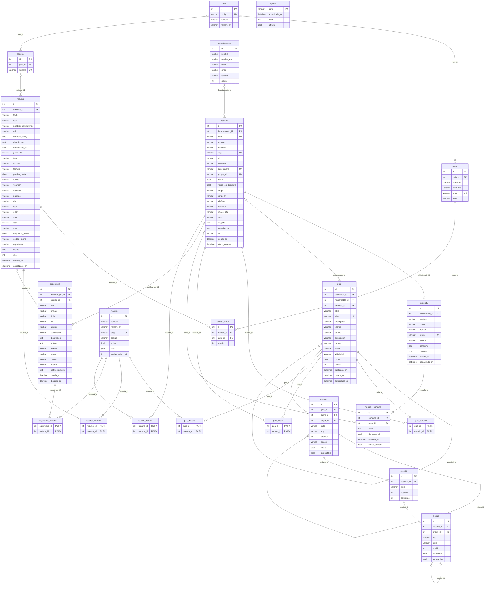

# 4. Diccionario de datos

> Este capítulo se genera con `scripts/generar-diagrama-er.py` a partir de las entidades de Doctrine (`src/Entity`). No lo edites a mano: cambia la entidad, crea la migración y vuelve a generarlo.

La base de datos tiene **22 tablas** (más `doctrine_migration_versions`, que lleva el registro de las migraciones aplicadas). Todas usan InnoDB con `utf8mb4` y `utf8mb4_unicode_ci`.

**Convenciones.** Claves primarias `id` autoincrementales (salvo `ajuste`, cuya clave es `clave`, y las tablas intermedias, con clave compuesta). Las columnas `*_id` son claves foráneas. Las fechas se guardan como `DATETIME` en la hora del servidor. Los valores de las enumeraciones (`App\Enum`) se guardan como texto.

| Tabla | Entidad | Para qué sirve |
| ------------ | ------------ | ---------------------------- |
| [`ajuste`](#ajuste) | Ajuste | Configuración editable desde el panel (Apariencia e Integraciones). Reemplaza las variables de entorno. |
| [`autor`](#autor) | Autor | Autores personales o institucionales de los recursos. |
| [`bloque`](#bloque) | Bloque | Unidad de contenido de una sección (texto, lista de recursos, libros, video…). |
| [`consulta`](#consulta) | Consulta | Conversación iniciada desde el formulario «Escribir a…» de la ficha de un bibliotecario. |
| [`departamento`](#departamento) | Departamento | Agrupa al personal en el directorio. |
| [`editorial`](#editorial) | Editorial | Editoriales de libros y revistas. |
| [`guia`](#guia) | Guia | Guía temática. |
| [`guia_coeditor`](#guia_coeditor) | (intermedia) | Personas que editan el contenido de una guía además del responsable. |
| [`guia_lector`](#guia_lector) | (intermedia) | Usuarios que pueden ver una guía restringida. |
| [`guia_materia`](#guia_materia) | (intermedia) | Materias de una guía. |
| [`materia`](#materia) | Materia | Materias: las 334 categorías ASJC de Scopus y las materias propias de la UCN. |
| [`mensaje_consulta`](#mensaje_consulta) | MensajeConsulta | Mensajes de una consulta. |
| [`pais`](#pais) | Pais | Países ISO 3166-1. |
| [`pestana`](#pestana) | Pestana | Pestaña (o subpestaña) de una guía. |
| [`recurso`](#recurso) | Recurso | Lista maestra de recursos bibliográficos A-Z. |
| [`recurso_autor`](#recurso_autor) | RecursoAutor | Autores de un recurso, en orden. |
| [`recurso_materia`](#recurso_materia) | (intermedia) | Materias de un recurso. |
| [`seccion`](#seccion) | Seccion | Sección de una pestaña; contiene bloques en una o más columnas. |
| [`sugerencia`](#sugerencia) | Sugerencia | Recurso sugerido por el público desde el formulario «Sugerir un recurso». |
| [`sugerencia_materia`](#sugerencia_materia) | (intermedia) | Materias propuestas para una sugerencia. |
| [`usuario`](#usuario) | Usuario | Personal de la biblioteca y lectores de guías restringidas. |
| [`usuario_materia`](#usuario_materia) | (intermedia) | Materias de especialidad de una persona (directorio y sugerencias). |

## ajuste

Configuración editable desde el panel (Apariencia e Integraciones). Reemplaza las variables de entorno. Entidad `App\Entity\Ajuste`.

| Columna | Tipo | Nulo | Clave | Descripción |
| ------------ | ---------- | :--: | :----: | ------------------------------ |
| `clave` | varchar(60) |  | PK | Nombre del ajuste; coincide con la variable de entorno que reemplaza (p. ej. PROXY_URL) |
| `actualizado_en` | datetime |  |  |  |
| `valor` | text |  |  | Valor; si «cifrado», va cifrado con sodium y una clave derivada de APP_SECRET |
| `cifrado` | bool |  |  | Secreto (clave de API, contraseña): nunca se muestra en el panel |

## autor

Autores personales o institucionales de los recursos. Entidad `App\Entity\Autor`.

| Columna | Tipo | Nulo | Clave | Descripción |
| ------------ | ---------- | :--: | :----: | ------------------------------ |
| `id` | int |  | PK |  |
| `pais_id` | int | sí | FK | → `pais.id` (al borrar el destino: queda en nulo) |
| `nombres` | varchar(120) |  |  |  |
| `apellidos` | varchar(150) |  |  | Apellidos; un autor institucional lleva aquí el nombre completo |
| `orcid` | varchar(19) | sí | UQ | ORCID iD (0000-0000-0000-000X), validado |
| `sexo` | varchar(20) |  |  | Valores: `femenino`, `masculino`, `otro`, `no_informado` |

Índices adicionales: índice (apellidos, nombres).

## bloque

Unidad de contenido de una sección (texto, lista de recursos, libros, video…). Entidad `App\Entity\Bloque`.

| Columna | Tipo | Nulo | Clave | Descripción |
| ------------ | ---------- | :--: | :----: | ------------------------------ |
| `id` | int |  | PK |  |
| `seccion_id` | int |  | FK | → `seccion.id` (al borrar el destino: se borra en cascada) |
| `origen_id` | int | sí | FK | Si no es nulo, el bloque es un vínculo: muestra el tipo, título y contenido del original. → `bloque.id` (al borrar el destino: se borra en cascada) |
| `tipo` | varchar(20) |  |  | Tipo de bloque; define la forma de «contenido». Valores: `texto`, `recursos`, `perfil`, `video`, `busqueda`, `enlaces`, `libros`, `revistas`, `diapositivas` |
| `titulo` | varchar(150) | sí |  |  |
| `posicion` | int |  |  | Orden dentro de la sección |
| `contenido` | json |  |  | Datos del bloque según su tipo (ver «Contenido de los bloques») |
| `compartible` | bool |  |  | Se ofrece en la biblioteca «Bloque de otra guía» para vincularlo o copiarlo |

## consulta

Conversación iniciada desde el formulario «Escribir a…» de la ficha de un bibliotecario. Entidad `App\Entity\Consulta`.

| Columna | Tipo | Nulo | Clave | Descripción |
| ------------ | ---------- | :--: | :----: | ------------------------------ |
| `id` | int |  | PK |  |
| `bibliotecario_id` | int |  | FK | Bibliotecario a quien se escribió. → `usuario.id` (al borrar el destino: se borra en cascada) |
| `nombre` | varchar(120) |  |  |  |
| `correo` | varchar(180) |  |  |  |
| `asunto` | varchar(200) |  |  |  |
| `token` | varchar(64) |  | UQ | Enlace privado /consulta/{token} con que la persona sigue la conversación |
| `idioma` | varchar(2) |  |  |  |
| `pendiente` | bool |  |  | El último mensaje es de la persona (falta respuesta) |
| `cerrada` | bool |  |  |  |
| `creada_en` | datetime |  |  |  |
| `actualizada_en` | datetime |  |  |  |

Índices adicionales: índice (pendiente, cerrada).

## departamento

Agrupa al personal en el directorio. Entidad `App\Entity\Departamento`.

| Columna | Tipo | Nulo | Clave | Descripción |
| ------------ | ---------- | :--: | :----: | ------------------------------ |
| `id` | int |  | PK |  |
| `nombre` | varchar(120) |  |  |  |
| `nombre_en` | varchar(120) | sí |  |  |
| `sede` | varchar(20) | sí |  | Valores: `antofagasta`, `coquimbo` |
| `email` | varchar(180) | sí |  |  |
| `telefono` | varchar(40) | sí |  |  |
| `orden` | int |  |  | Posición en el directorio de bibliotecarios |

## editorial

Editoriales de libros y revistas. Entidad `App\Entity\Editorial`.

| Columna | Tipo | Nulo | Clave | Descripción |
| ------------ | ---------- | :--: | :----: | ------------------------------ |
| `id` | int |  | PK |  |
| `pais_id` | int | sí | FK | → `pais.id` (al borrar el destino: queda en nulo) |
| `nombre` | varchar(150) |  | UQ |  |

## guia

Guía temática. Entidad `App\Entity\Guia`.

| Columna | Tipo | Nulo | Clave | Descripción |
| ------------ | ---------- | :--: | :----: | ------------------------------ |
| `id` | int |  | PK |  |
| `traduccion_id` | int | sí | FK | La misma guía en el otro idioma. → `guia.id` (al borrar el destino: queda en nulo) |
| `responsable_id` | int | sí | FK | Editor responsable: publica, cambia los datos y elimina. → `usuario.id` (al borrar el destino: queda en nulo) |
| `principal_id` | int | sí | FK | Guía principal de la que es subguía. → `guia.id` (al borrar el destino: queda en nulo) |
| `titulo` | varchar(200) |  |  |  |
| `slug` | varchar(120) |  | UQ | Dirección pública /{idioma}/guias/{slug} |
| `descripcion` | varchar(500) | sí |  |  |
| `idioma` | varchar(2) |  |  |  |
| `estado` | varchar(20) |  |  | Valores: `borrador`, `publicada` |
| `disposicion` | varchar(20) |  |  | Pestañas arriba o menú lateral. Valores: `pestanas`, `menu_lateral` |
| `banner` | varchar(100) | sí |  | Archivo en public/uploads/guias |
| `icono` | varchar(100) | sí |  | Archivo en public/uploads/guias |
| `visibilidad` | varchar(20) |  |  | Pública o solo para usuarios asignados (guia_lector). Valores: `publica`, `restringida` |
| `comun` | bool |  |  | Guía de contenido común: no se publica; todo su contenido es reutilizable |
| `visitas` | int |  |  |  |
| `publicada_en` | datetime | sí |  |  |
| `creada_en` | datetime |  |  |  |
| `actualizada_en` | datetime |  |  |  |

Índices adicionales: índice (estado).

## guia_coeditor

Personas que editan el contenido de una guía además del responsable.

| Columna | Tipo | Nulo | Clave | Descripción |
| ------------ | ---------- | :--: | :----: | ------------------------------ |
| `guia_id` | int |  | PK FK | → `guia.id` (al borrar el destino: se borra en cascada) |
| `usuario_id` | int |  | PK FK | → `usuario.id` (al borrar el destino: se borra en cascada) |

## guia_lector

Usuarios que pueden ver una guía restringida.

| Columna | Tipo | Nulo | Clave | Descripción |
| ------------ | ---------- | :--: | :----: | ------------------------------ |
| `guia_id` | int |  | PK FK | → `guia.id` (al borrar el destino: se borra en cascada) |
| `usuario_id` | int |  | PK FK | → `usuario.id` (al borrar el destino: se borra en cascada) |

## guia_materia

Materias de una guía.

| Columna | Tipo | Nulo | Clave | Descripción |
| ------------ | ---------- | :--: | :----: | ------------------------------ |
| `guia_id` | int |  | PK FK | → `guia.id` (al borrar el destino: se borra en cascada) |
| `materia_id` | int |  | PK FK | → `materia.id` (al borrar el destino: se borra en cascada) |

## materia

Materias: las 334 categorías ASJC de Scopus y las materias propias de la UCN. Entidad `App\Entity\Materia`.

| Columna | Tipo | Nulo | Clave | Descripción |
| ------------ | ---------- | :--: | :----: | ------------------------------ |
| `id` | int |  | PK |  |
| `nombre` | varchar(150) |  |  |  |
| `nombre_en` | varchar(150) | sí |  |  |
| `slug` | varchar(160) |  | UQ |  |
| `codigo` | varchar(30) | sí |  | Código interno UCN de la carrera o asignatura |
| `activa` | bool |  |  |  |
| `asjc` | json |  |  | Códigos ASJC en que se clasifica una materia propia (lista JSON de enteros) |
| `codigo_asjc` | int | sí | UQ | Código ASJC si la materia ES una de las 334 categorías base (no se elimina) |

## mensaje_consulta

Mensajes de una consulta. Entidad `App\Entity\MensajeConsulta`.

| Columna | Tipo | Nulo | Clave | Descripción |
| ------------ | ---------- | :--: | :----: | ------------------------------ |
| `id` | int |  | PK |  |
| `consulta_id` | int |  | FK | → `consulta.id` (al borrar el destino: se borra en cascada) |
| `autor_id` | int | sí | FK | → `usuario.id` (al borrar el destino: queda en nulo) |
| `texto` | text |  |  |  |
| `de_personal` | bool |  |  | Lo escribió el personal (si no, la persona que consultó) |
| `enviado_en` | datetime |  |  |  |
| `correo_enviado` | bool |  |  | El aviso por correo salió bien |

## pais

Países ISO 3166-1. Entidad `App\Entity\Pais`.

| Columna | Tipo | Nulo | Clave | Descripción |
| ------------ | ---------- | :--: | :----: | ------------------------------ |
| `id` | int |  | PK |  |
| `codigo` | varchar(2) |  | UQ | ISO 3166-1 alfa-2 |
| `nombre` | varchar(100) |  |  |  |
| `nombre_en` | varchar(100) | sí |  |  |

## pestana

Pestaña (o subpestaña) de una guía. Entidad `App\Entity\Pestana`.

| Columna | Tipo | Nulo | Clave | Descripción |
| ------------ | ---------- | :--: | :----: | ------------------------------ |
| `id` | int |  | PK |  |
| `guia_id` | int |  | FK | → `guia.id` (al borrar el destino: se borra en cascada) |
| `padre_id` | int | sí | FK | Pestaña de la que es subpestaña. → `pestana.id` (al borrar el destino: queda en nulo) |
| `origen_id` | int | sí | FK | Si no es nulo, la pestaña es un vínculo y muestra las secciones del original. → `pestana.id` (al borrar el destino: se borra en cascada) |
| `titulo` | varchar(100) |  |  |  |
| `slug` | varchar(110) |  |  |  |
| `posicion` | int |  |  |  |
| `enlace` | varchar(500) | sí |  | Si tiene enlace, la pestaña lleva a esa dirección en vez de tener contenido |
| `nueva` | bool |  |  | Abre el enlace en otra ventana |
| `compartible` | bool |  |  |  |

## recurso

Lista maestra de recursos bibliográficos A-Z. Entidad `App\Entity\Recurso`.

| Columna | Tipo | Nulo | Clave | Descripción |
| ------------ | ---------- | :--: | :----: | ------------------------------ |
| `id` | int |  | PK |  |
| `editorial_id` | int | sí | FK | → `editorial.id` (al borrar el destino: queda en nulo) |
| `titulo` | varchar(200) |  |  |  |
| `letra` | varchar(1) |  |  | Primera letra del título sin tildes (A-Z) o «#»; índice de la lista A-Z |
| `nombres_alternativos` | varchar(255) | sí |  |  |
| `url` | varchar(1000) |  |  | URL original, sin el prefijo del proxy |
| `requiere_proxy` | bool |  |  | El enlace público pasa por el proxy AccesUM |
| `descripcion` | text | sí |  |  |
| `descripcion_en` | text | sí |  |  |
| `proveedor` | varchar(120) | sí |  |  |
| `tipo` | varchar(20) |  |  | Valores: `base_datos`, `revistas`, `articulo`, `libros`, `repositorio`, `normas`, `multimedia`, `herramienta`, `sitio_web` |
| `acceso` | varchar(20) |  |  | Valores: `suscripcion`, `abierto`, `prueba` |
| `formato` | varchar(20) | sí |  | Valores: `electronico`, `impreso`, `ambos` |
| `prueba_hasta` | date | sí |  | Fin de un acceso de prueba: después deja de mostrarse |
| `fuente` | varchar(255) | sí |  | Revista en que se publicó (artículos) |
| `volumen` | varchar(20) | sí |  |  |
| `fasciculo` | varchar(20) | sí |  |  |
| `paginas` | varchar(30) | sí |  |  |
| `doi` | varchar(200) | sí |  |  |
| `isbn` | varchar(20) | sí |  |  |
| `eisbn` | varchar(20) | sí |  |  |
| `anio` | smallint | sí |  |  |
| `issn` | varchar(9) | sí |  |  |
| `eissn` | varchar(9) | sí |  |  |
| `disponible_desde` | date | sí |  |  |
| `codigo_norma` | varchar(60) | sí |  |  |
| `organismo` | varchar(120) | sí |  |  |
| `visible` | bool |  |  |  |
| `clics` | int |  |  | Contador de visitas por /recursos/{id}/ir |
| `creado_en` | datetime |  |  |  |
| `actualizado_en` | datetime |  |  |  |

Índices adicionales: índice (letra).

## recurso_autor

Autores de un recurso, en orden. Entidad `App\Entity\RecursoAutor`.

| Columna | Tipo | Nulo | Clave | Descripción |
| ------------ | ---------- | :--: | :----: | ------------------------------ |
| `id` | int |  | PK |  |
| `recurso_id` | int |  | FK | → `recurso.id` (al borrar el destino: se borra en cascada) |
| `autor_id` | int |  | FK | → `autor.id` (al borrar el destino: se borra en cascada) |
| `posicion` | int |  |  | Orden del autor en la cita |

Índices adicionales: única (recurso_id, autor_id).

## recurso_materia

Materias de un recurso.

| Columna | Tipo | Nulo | Clave | Descripción |
| ------------ | ---------- | :--: | :----: | ------------------------------ |
| `recurso_id` | int |  | PK FK | → `recurso.id` (al borrar el destino: se borra en cascada) |
| `materia_id` | int |  | PK FK | → `materia.id` (al borrar el destino: se borra en cascada) |

## seccion

Sección de una pestaña; contiene bloques en una o más columnas. Entidad `App\Entity\Seccion`.

| Columna | Tipo | Nulo | Clave | Descripción |
| ------------ | ---------- | :--: | :----: | ------------------------------ |
| `id` | int |  | PK |  |
| `pestana_id` | int |  | FK | → `pestana.id` (al borrar el destino: se borra en cascada) |
| `titulo` | varchar(150) | sí |  |  |
| `posicion` | int |  |  |  |
| `columnas` | int |  |  | Columnas en que se reparten los bloques (1 a 3) |

## sugerencia

Recurso sugerido por el público desde el formulario «Sugerir un recurso». Entidad `App\Entity\Sugerencia`.

| Columna | Tipo | Nulo | Clave | Descripción |
| ------------ | ---------- | :--: | :----: | ------------------------------ |
| `id` | int |  | PK |  |
| `decidida_por_id` | int | sí | FK | Quién la aprobó o rechazó. → `usuario.id` (al borrar el destino: queda en nulo) |
| `recurso_id` | int | sí | FK | Recurso creado al aprobarla. → `recurso.id` (al borrar el destino: queda en nulo) |
| `tipo` | varchar(20) |  |  | Valores: `base_datos`, `revistas`, `articulo`, `libros`, `repositorio`, `normas`, `multimedia`, `herramienta`, `sitio_web` |
| `formato` | varchar(20) | sí |  | Valores: `electronico`, `impreso`, `ambos` |
| `titulo` | varchar(255) |  |  |  |
| `url` | varchar(500) | sí |  |  |
| `autores` | varchar(255) | sí |  |  |
| `identificador` | varchar(30) | sí |  | ISBN, ISSN o DOI indicado por quien sugiere |
| `descripcion` | text | sí |  |  |
| `motivo` | text | sí |  |  |
| `nombre` | varchar(120) |  |  |  |
| `correo` | varchar(180) |  |  |  |
| `idioma` | varchar(2) |  |  |  |
| `estado` | varchar(20) |  |  | Valores: `pendiente`, `aprobada`, `rechazada` |
| `motivo_rechazo` | text | sí |  |  |
| `creada_en` | datetime |  |  |  |
| `decidida_en` | datetime | sí |  |  |

Índices adicionales: índice (estado).

## sugerencia_materia

Materias propuestas para una sugerencia.

| Columna | Tipo | Nulo | Clave | Descripción |
| ------------ | ---------- | :--: | :----: | ------------------------------ |
| `sugerencia_id` | int |  | PK FK | → `sugerencia.id` (al borrar el destino: se borra en cascada) |
| `materia_id` | int |  | PK FK | → `materia.id` (al borrar el destino: se borra en cascada) |

## usuario

Personal de la biblioteca y lectores de guías restringidas. Entidad `App\Entity\Usuario`.

| Columna | Tipo | Nulo | Clave | Descripción |
| ------------ | ---------- | :--: | :----: | ------------------------------ |
| `id` | int |  | PK |  |
| `departamento_id` | int | sí | FK | Departamento en el directorio. → `departamento.id` (al borrar el destino: queda en nulo) |
| `email` | varchar(180) |  | UQ |  |
| `nombre` | varchar(100) |  |  |  |
| `apellidos` | varchar(100) |  |  |  |
| `slug` | varchar(120) |  | UQ |  |
| `rol` | varchar(30) |  |  | Valores: `ROLE_ADMINISTRADOR`, `ROLE_EDITOR`, `ROLE_COLABORADOR`, `ROLE_LECTOR` |
| `password` | varchar(255) | sí |  | Hash de la contraseña propia (nulo si entra solo por LDAP o Google) |
| `ldap_usuario` | varchar(100) | sí | UQ | Usuario institucional para LDAP |
| `google_id` | varchar(64) | sí | UQ | Identificador de Google, se completa en el primer acceso |
| `activo` | bool |  |  |  |
| `visible_en_directorio` | bool |  |  |  |
| `cargo` | varchar(120) | sí |  |  |
| `cargo_en` | varchar(120) | sí |  |  |
| `telefono` | varchar(40) | sí |  |  |
| `ubicacion` | varchar(120) | sí |  |  |
| `enlace_cita` | varchar(500) | sí |  | Enlace para agendar una cita |
| `sede` | varchar(20) | sí |  | Valores: `antofagasta`, `coquimbo` |
| `biografia` | text | sí |  |  |
| `biografia_en` | text | sí |  |  |
| `foto` | varchar(80) | sí |  | Archivo en public/uploads/personal |
| `creado_en` | datetime |  |  |  |
| `ultimo_acceso` | datetime | sí |  |  |

## usuario_materia

Materias de especialidad de una persona (directorio y sugerencias).

| Columna | Tipo | Nulo | Clave | Descripción |
| ------------ | ---------- | :--: | :----: | ------------------------------ |
| `usuario_id` | int |  | PK FK | → `usuario.id` (al borrar el destino: se borra en cascada) |
| `materia_id` | int |  | PK FK | → `materia.id` (al borrar el destino: se borra en cascada) |

## Diagrama completo en Mermaid

GitHub dibuja este bloque como diagrama. También sirve para pegarlo en https://mermaid.live o en cualquier herramienta compatible.

